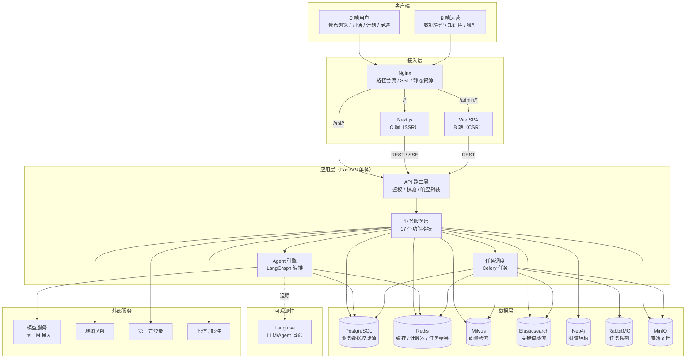
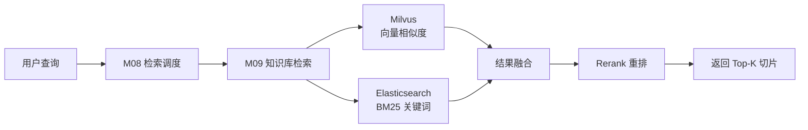
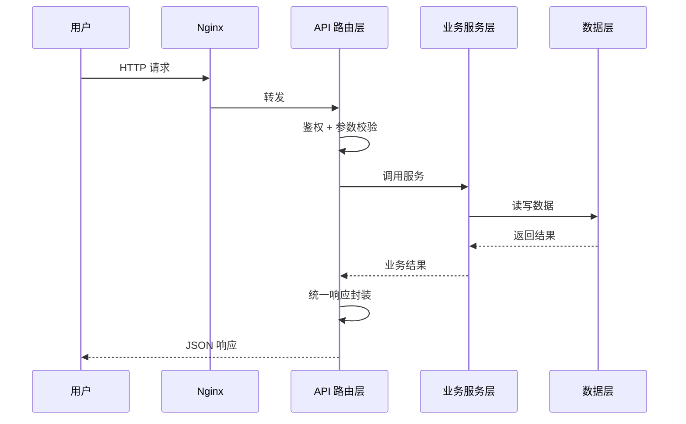
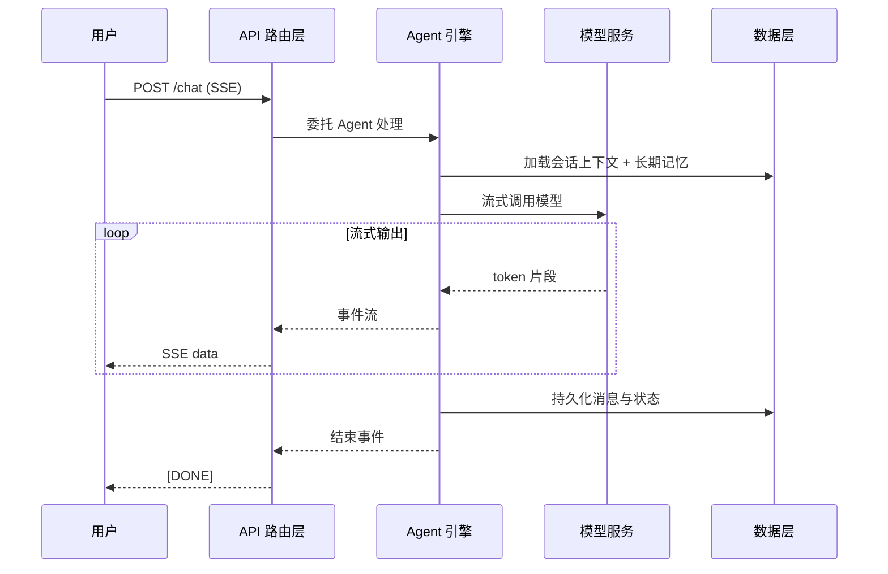
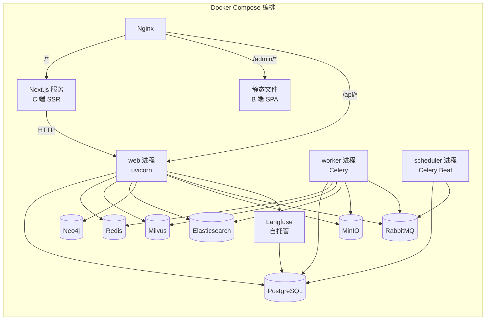
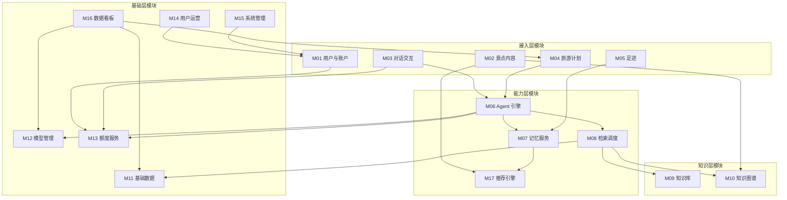

# 云游坊 - 整体架构设计

> 本文档为设计第二阶段产出，基于 `docs/design/01.功能模块梳理.md` 与 `docs/云游坊-需求文档.md`。
> 本阶段只确定整体方案，不展开具体表结构与接口定义，不编写业务代码。
>
> 文档版本：v1.0
> 编写日期：2026-11-05
> 状态：待审核

---

## 一、技术选型

### 1.1 选型依据

选型遵循三条原则：

1. **已有约束优先**：项目已存在的 `pyproject.toml`、`docs/rules/` 中的规范为硬约束
2. **匹配需求复杂度**：需求中 Agent 的状态机、ReAct 循环、中断恢复等能力，需要对应框架支撑
3. **避免过度设计**：当前为单体阶段，不引入微服务等重型架构

### 1.2 后端技术栈

| 层次 | 选型 | 版本 | 选型依据 |
|------|------|------|---------|
| 语言 | Python | 3.12 | 项目现状（`.python-version`） |
| Web 框架 | FastAPI | ≥0.162 | 项目现状；原生异步、自动 OpenAPI 文档 |
| 数据校验 | Pydantic | ≥2.14 | 项目现状；与 FastAPI 深度集成 |
| 配置管理 | pydantic-settings | ≥2.16 | 项目现状；环境变量与类型校验 |
| ASGI 服务器 | Uvicorn | ≥0.54 | 项目现状；支持 HTTP/1.1 与 WebSocket |
| 包管理 | uv | - | 项目现状（有 `uv.lock`） |

### 1.3 Agent 编排技术栈

| 组件 | 选型 | 选型依据 |
|------|------|---------|
| Agent 编排 | **LangGraph** | 原生支持状态机、循环、中断恢复、检查点。与需求确认的「6 节点状态机 + ReAct 循环 + 中断等待用户 + 工作记忆持久化」高度契合 |
| 基础抽象 | **LangChain** | LangGraph 构建于 LangChain 之上，工具定义、消息模型、提示模板等基础组件依赖它，无法单独剥离 |
| 模型接入 | **LiteLLM** | 已确认「统一 OpenAI 兼容封装」，LiteLLM 支持 100+ 提供商、内置重试与错误映射，避免自研适配层 |
| 向量库客户端 | Milvus SDK | 需求已明确 Milvus |

**LangGraph 与 LangChain 的关系说明**：

```
LangChain（基础抽象层）
  ├── 消息模型（HumanMessage / AIMessage / SystemMessage）
  ├── Tool 定义与调用协议
  ├── Prompt 模板
  └── 文档加载器 / 文本分割器
       ↓ 被依赖
LangGraph（编排层）
  ├── StateGraph（状态机）
  ├── Checkpointer（检查点/中断恢复）
  ├── 条件路由
  └── 循环控制
```

实际使用中两者需同时引入，这是框架的固有设计而非重复依赖。

### 1.4 数据存储技术栈

| 存储 | 选型 | 用途 | 选型依据 |
|------|------|------|---------|
| 关系数据库 | **PostgreSQL** | 业务数据权威源 | JSONB 承载行程详情等半结构化数据；事务能力强；生态成熟 |
| 向量数据库 | **Milvus** | RAG 语义检索（向量） | 需求 2.2.4.4 已明确；支持 Collection 隔离、HNSW 索引 |
| 搜索引擎 | **Elasticsearch 9.x** | RAG 关键词检索（BM25） | 混合检索需要；中文分词（IK 插件）支撑景区文档场景 |
| 图数据库 | **Neo4j** | 知识图谱关系遍历 | 原生图查询支持多跳遍历，性能不随跳数衰减；Cypher 表达力强 |
| 缓存 | **Redis** | 会话状态加速、额度计数、热点数据、Celery 结果存储 | 原子计数适合额度自然日重置场景 |
| 对象存储 | **MinIO** | 原始上传文档 | S3 协议兼容；多实例部署下共享存储 |
| 消息队列 | **RabbitMQ** | Celery Broker | 专业消息队列，保证任务投递不丢失 |

**存储分层原则（关键）**：

> **PostgreSQL 是业务数据的唯一权威源，Redis 仅为加速层。**
>
> 即使会话状态、短期记忆存放在 Redis 中，PostgreSQL 也必须持久化完整副本。原因：Redis 若断电或重启，用户将无法接回之前的对话与规划流程。Redis 中的数据丢失应仅影响性能，不应影响数据完整性。

**Neo4j 的数据边界原则**：

> **Neo4j 只存储图谱结构与关系，不冗余景点基础信息。**
>
> 图谱节点仅保存实体标识（如 `attraction_id`）与关系数据。景点名称、简介、坐标等业务属性仍以 PostgreSQL 为唯一来源。
>
> 这样做的目的：消除 PG 与 Neo4j 之间的数据同步问题。查阅图谱后需要展示详情时，回 PostgreSQL 补齐。

**Milvus 与 ES 的职责分工**：

> 两者都服务于 RAG 检索，但承担不同角色，且**互不依赖**。

| 维度 | Milvus | Elasticsearch |
|------|--------|---------------|
| 检索方式 | 向量相似度（语义匹配） | BM25 关键词匹配（字面匹配） |
| 擅长场景 | "故宫有什么好玩的" → 匹配语义相关内容 | "太和殿" → 精确匹配专有名词 |
| 数据来源 | 切片文本经向量化模型转换 | 切片原始文本 |
| 中文处理 | 依赖 Embedding 模型的语义能力 | 需 IK 分词插件 |
| 是否参与重建 | ✅ 向量化模型变更时需重建 | ❌ **不涉及向量化，无需重建** |
| 切分参数变更 | 需重建（切片粒度变化） | 需重新索引（影响检索粒度，但不涉及向量） |

**异步写入策略**：

文档切分完成后，**并行**写入 Milvus 与 ES：

```
切分完成
  ├─→ 向量化模型 → 写 Milvus
  └─→ 写 ES（IK 分词）
       ↓
  两者都成功后，文档状态置为「已完成」
```

**部分失败的处理**（待详细设计阶段细化）：
- 若一方写入成功、另一方失败，文档状态标记为「部分成功」，需明确后续补偿策略
- 基本的处理原则：以 Milvus 写入成功为准（因为向量检索是主要检索方式），ES 失败可触发重试

### 1.5 前端技术栈

前端采用**双应用架构**：C 端使用 Next.js（需 SEO），B 端使用 Vite SPA（无 SEO 需求）。

| 组件 | C 端 | B 端 | 选型依据 |
|------|------|------|---------|
| 框架 | **Next.js 14**（App Router） | **React 18** + TypeScript | C 端需 SSR 支持 SEO；B 端无此需求，Vite 更轻快 |
| UI 组件库 | Ant Design 5 | Ant Design 5 | 中后台组件完备；C 端复用基础组件 |
| 构建 | Next.js 内置（Turbopack） | Vite | 各自最优 |
| 状态管理 | **TanStack Query + Zustand** | **TanStack Query + Zustand** | TanStack Query 管服务端状态（缓存、失效、分页）；Zustand 管客户端状态 |
| 路由 | Next.js App Router | React Router v6 | 各自标准方案 |
| 请求层 | Axios + 拦截器 | Axios + 拦截器 | 统一处理鉴权、错误码 |
| 流式响应 | fetch + ReadableStream | - | B 端无 SSE 需求；C 端需处理对话流 |

**渲染策略**：C 端内容页采用 **SSR**（服务端渲染），每次请求返回最新数据，保证运营修改后立即生效。需登录的页面（对话、计划、足迹、个人中心）走客户端渲染。

**C 端与后端的数据获取方式**：Next.js 服务端渲染时，通过 HTTP 调用 FastAPI 接口获取数据，前后端完全解耦。

### 1.6 关键技术决策说明

#### 决策 1：引入 Neo4j 图数据库存储知识图谱

**背景**：知识图谱（M10）需要存储实体与关系，支持多跳查询。

**已确认方案**：**使用 Neo4j 存储图谱结构与关系**。

**依据**：
1. 原生图遍历对多跳查询友好，性能不随跳数显著衰减
2. Cypher 查询语言表达力强，便于实现「多跳推理」类查询
3. 需求中的多跳场景（如「康熙住过的地方附近有什么好吃的？」）涉及 3-4 跳，图数据库更适合

**数据边界（关键设计）**：

Neo4j **只存储图谱结构与关系**，不冗余景点业务属性：

| 数据 | 存储位置 | 说明 |
|------|---------|------|
| 景点 ID | Neo4j 节点 | 仅作为标识 |
| 实体间关系 | Neo4j 边 | 建造者、相关人物、附近景点等 |
| 景点的名称、简介、坐标等 | **仅 PostgreSQL** | Neo4j 不存 |
| 人物/事件的详细信息 | **仅 PostgreSQL** | Neo4j 不存 |

**这样设计的收益**：
- 消除 PG 与 Neo4j 之间的数据同步问题
- 景点信息修改后无需同步到 Neo4j
- 图谱查询后若需展示详情，回 PostgreSQL 补齐即可

**代价**：图谱查询后需二次查 PG 补全信息，高频查询场景下需考虑缓存。

#### 决策 2：使用 MinIO 对象存储原始文件

**背景**：知识库（M09）需保存用户上传的原始文档（PDF、Word 等），供预览与重新解析。

**已确认方案**：**使用 MinIO 对象存储**。

**依据**：
1. S3 协议兼容，后续可平滑迁移至云对象存储（阿里云 OSS / 腾讯云 COS）
2. 多实例部署下天然支持共享存储（本地文件系统无法满足）
3. 自带纠删码，可靠性高于单机磁盘
4. 可独立扩容，不受应用服务器磁盘容量限制

**存储路径约定**（待细化阶段确定具体规则）：
- 按知识库 ID 组织目录层级
- 保留原始文件名与上传时间，便于追溯

#### 决策 3：Redis 与 PostgreSQL 的数据边界

**背景**：已确认 Redis 存会话状态与短期记忆，但同时要求 PG 持久化。

**边界划分**：

| 数据类型 | PostgreSQL | Redis | 说明 |
|---------|-----------|-------|------|
| 会话消息链 | ✅ 权威源 | ⚠️ 缓存 | 每轮对话后写 PG；Redis 缓存最新 N 轮加速读取 |
| 长期记忆 | ✅ 权威源 | ⚠️ 缓存 | 用户偏好等结构化数据 |
| 工作记忆 | ✅ 权威源 | ⚠️ 缓存 | 行程规划的中间状态 |
| 额度计数 | ✅ 明细记录 | ✅ 实时计数 | Redis 原子递增；PG 存明细供审计与统计 |
| 模型配置 | ✅ 权威源 | ⚠️ 缓存 | 变更频率低，缓存降低查询压力 |
| 热门景点排行 | ✅ 计算源 | ⚠️ 缓存 | 定时任务写入 PG，Redis 缓存结果 |

**原则**：
- 写操作：先写 PostgreSQL，成功后再更新/失效 Redis
- 读操作：优先读 Redis，未命中则读 PostgreSQL 并回填
- Redis 不可用时：降级为直接读 PostgreSQL，**服务不中断**

#### 决策 4：异步任务使用 Celery + RabbitMQ + Redis

**背景**：文档处理状态机（排队 → 解析 → 切分 → 向量化）需要异步执行，MinerU 解析单页需数秒。

**已确认方案**：

| 组件 | 选型 | 职责 |
|------|------|------|
| 任务框架 | **Celery** | 任务定义、调度、重试、状态跟踪 |
| Broker | **RabbitMQ** | 任务投递，保证不丢失 |
| Result Backend | **Redis** | 存储任务执行结果，便于快速查询 |

**选型理由**：
- **Celery**：生态成熟，功能完备（重试、优先级、任务链），社区资料丰富
- **RabbitMQ 作 Broker**：专业消息队列，任务不会因重启丢失；相比 Redis 作 Broker 更可靠
- **Redis 作 Result Backend**：结果读取频繁且可容忍丢失，用 Redis 更快

**为什么不用 FastAPI BackgroundTasks**：需求要求文档处理状态可查询、可取消、可重试，`BackgroundTasks` 无持久化、进程重启任务丢失、无法查询状态，不满足要求。

#### 决策 5：部署形态

**已确认方案**：单体应用，进程分离，Docker Compose 单机部署

```
┌─────────────────┐  ┌─────────────────┐  ┌─────────────────┐
│  Web 进程        │  │  Worker 进程    │  │  Scheduler 进程 │
│  (FastAPI)      │  │  (Celery 消费)  │  │  (Celery Beat)  │
└─────────────────┘  └─────────────────┘  └─────────────────┘
```

三类进程共享同一套代码与数据层，通过不同启动命令区分角色。

---

## 二、整体架构设计

### 2.1 架构总览



**路由分流规则**：

| 路径 | 目标 | 说明 |
|------|------|------|
| `/api/*` | FastAPI | 所有业务接口 |
| `/admin/*` | Vite SPA 静态文件 | B 端后台 |
| `/*` | Next.js 服务 | C 端页面（SSR） |

### 2.2 技术分层与职责

| 层次 | 职责 | 关键约束 |
|------|------|---------|
| **客户端层** | C 端 Next.js（SSR）渲染与交互；B 端 Vite SPA 渲染 | 两个应用独立构建、独立部署，共享 Ant Design 组件规范 |
| **接入层** | 路径分流、反向代理、SSL 终止、静态资源托管 | Nginx 将 `/api`、`/admin`、`/*` 分发到不同目标 |
| **API 路由层** | 请求校验、鉴权、权限判定、统一响应封装、错误码映射 | 不包含业务逻辑 |
| **业务服务层** | 17 个功能模块的业务实现 | 模块间通过明确的接口调用，不直接访问其他模块的数据表 |
| **Agent 引擎** | 意图识别、流程编排、工具调用、上下文管理 | 独立于业务服务层，通过工具接口反向调用业务能力 |
| **任务调度** | 异步任务消费、定时任务触发 | 与 Web 进程分离部署，共享数据层 |
| **数据层** | 业务数据持久化、缓存、向量与关键词检索、图遍历、文件存储 | PostgreSQL 为业务数据唯一权威源 |
| **可观测性** | LLM 调用追踪、Agent 链路追踪、成本分析 | 仅追踪 AI 相关调用，业务日志走常规方案 |

**混合检索链路（RAG 的核心）**：



**关键点**：Milvus 与 ES 的调用封装在 M09 内部，M08 无需感知底层有两个存储。检索参数（top-k、阈值、混合权重）都归属 M09 的知识库配置。

### 2.3 请求处理链路

#### 普通请求



#### 流式对话请求（SSE）



**关键设计**：Agent 处理与 SSE 推送解耦。Agent 的中间过程（意图识别、工具调用、思考）作为事件流推送，前端可选择展示或折叠。

### 2.4 部署视图



**组件清单**（共 14 个服务单元）：

| 类别 | 组件 |
|------|------|
| 应用进程 | Next.js / FastAPI Web / Celery Worker / Celery Beat |
| 前端 | B 端静态文件（Nginx 托管） |
| 数据存储 | PostgreSQL / Redis / Milvus / Elasticsearch / Neo4j / RabbitMQ / MinIO |
| 可观测性 | Langfuse（自托管） |
| 基础设施 | Nginx |

**说明**：
- web / worker / scheduler 三者使用**同一镜像**，通过启动命令区分角色
- Langfuse 自托管，依赖 PostgreSQL（建议独立实例或独立 database，避免与业务库争抢资源）
- Elasticsearch 需安装 **IK 中文分词插件**

---

## 三、模块架构设计

### 3.1 模块在代码中的组织方式

17 个功能模块在代码层面按「业务域」组织为包，而非按技术层横向切分。

```
backend/app/
├── modules/
│   ├── account/          # M01 用户与账户
│   ├── attraction/       # M02 景点内容
│   ├── chat/             # M03 对话交互
│   ├── trip_plan/        # M04 旅游计划
│   ├── footprint/        # M05 足迹
│   ├── agent/            # M06 Agent 引擎
│   ├── memory/           # M07 记忆服务
│   ├── retrieval/        # M08 检索调度
│   ├── knowledge_base/   # M09 知识库
│   ├── knowledge_graph/  # M10 知识图谱
│   ├── catalog/          # M11 基础数据
│   ├── model_gateway/    # M12 模型管理
│   ├── quota/            # M13 额度服务
│   ├── user_ops/         # M14 用户运营
│   ├── system/           # M15 系统管理
│   ├── dashboard/        # M16 数据看板
│   └── recommend/        # M17 推荐引擎
```

每个模块内部采用相同的分层结构（详见第四节目录设计）。

### 3.2 模块分层与依赖方向



**依赖规则**：

| 规则 | 说明 |
|------|------|
| **单向依赖** | 上层可依赖下层，下层不得反向依赖上层 |
| **同级解耦** | 同层模块之间不直接依赖，通过下层或事件解耦 |
| **禁止跨层直连** | 如 M02 不得直接调用 M09 的检索，须经 M08 |

### 3.3 各模块的架构位置与职责

| 模块 | 架构位置 | 核心职责 | 主要依赖 |
|------|---------|---------|---------|
| M01 用户与账户 | 接入层 | 认证、资料、偏好、隐私、额度展示 | M13 |
| M02 景点内容 | 接入层 | 浏览、搜索、详情展示、发现页 | M10、M17、M11 |
| M03 对话交互 | 接入层 | 消息收发、会话管理、SSE 推送、方案卡片渲染 | M06、M13 |
| M04 旅游计划 | 接入层 | 方案生成与调整、状态流转、编辑锁 | M06、M11 |
| M05 足迹 | 接入层 | 足迹生成、UGC、聚合视图 | M07 |
| M06 Agent 引擎 | 能力层 | 意图识别、流程编排、工具调用、上下文管理、模型调用 | M07、M08、M12、M13 |
| M07 记忆服务 | 能力层 | 短期/长期/工作记忆的读写、偏好学习、权重衰减 | - |
| M08 检索调度 | 能力层 | 检索策略路由、并行检索、结果融合、兜底 | M09、M10、M11、M12 |
| M09 知识库 | 知识层 | 知识库管理、文档归一化、切分、双写（向量化→Milvus / 原文→ES）、**混合检索执行** | M12 |
| M10 知识图谱 | 知识层 | 实体关系管理、图谱查询、可视化数据 | M11 |
| M11 基础数据 | 基础层 | 省市、景点、餐厅、酒店、交通的 CRUD | - |
| M12 模型管理 | 基础层 | 模型注册、分类、启停、默认值、连通性测试、调用统计 | - |
| M13 额度服务 | 基础层 | 额度计量、判定、重置 | - |
| M14 用户运营 | 基础层 | 用户列表、详情、分群、封禁 | M01 |
| M15 系统管理 | 基础层 | 角色权限、操作日志、站点配置 | M01 |
| M16 数据看板 | 基础层 | 指标统计与展示 | M11、M04、M12、M17 |
| M17 推荐引擎 | **能力层** | 热度计算、推荐策略、推荐理由生成、行为埋点 | M07、M12 |

### 3.4 跨模块协作机制

| 场景 | 机制 | 说明 |
|------|------|------|
| Agent 调用业务能力 | **工具注册表** | Agent 通过工具接口调用，不直接依赖业务模块实现 |
| 检索多源并行 | **统一检索接口** | M08 定义抽象接口，M09/M10/M11 各自实现 |
| **知识库混合检索** | **M09 内部封装** | Milvus（向量）+ ES（关键词）在 M09 内并行调用、融合、重排，对 M08 呈现为单一「知识库检索」接口 |
| 模型调用 | **统一网关** | 所有模块通过 M12 调用模型，不直接对接提供商 |
| **Agent 可观测性** | **Langfuse 自动埋点** | Agent 图执行、工具调用、模型调用自动上报 Trace |
| 权限校验 | **中间件 + 装饰器** | M15 提供能力，其他模块声明式使用 |
| 异步任务 | **任务队列** | 耗时操作提交队列，由 worker 消费 |
| 跨模块事件 | **预留事件机制** | 如足迹完成需更新记忆，通过事件而非直接调用 |

---

## 四、项目目录设计

### 4.1 整体目录结构

```
travel_project/
├── backend/                    # 后端应用（FastAPI）
├── frontend/                   # 前端（双应用）
│   ├── c-end/                  # C 端 Next.js（SSR）
│   └── b-end/                  # B 端 Vite SPA
├── docs/                       # 项目文档
├── prototype/                  # 页面原型（设计参考，不参与构建）
├── pyproject.toml              # Python 依赖与项目配置
├── uv.lock                     # 依赖锁定
├── .python-version             # Python 版本
├── docker-compose.yml          # 编排文件
├── .env.example                # 环境变量模板
└── README.md
```

**说明**：`frontend/c-end` 与 `frontend/b-end` 为两个独立构建的前端应用。当前不引入 monorepo 工具（如 pnpm workspace），两者的公共组件按需复制或后续抽取为共享包。

### 4.2 后端目录结构

```
backend/
├── app/
│   ├── main.py                     # 应用入口，创建 FastAPI 实例
│   ├── core/                       # 核心基础设施
│   │   ├── config.py               # 配置管理（pydantic-settings）
│   │   ├── security.py             # 认证、JWT、密码哈希
│   │   ├── exceptions.py           # 业务异常定义
│   │   ├── response.py             # 统一响应封装
│   │   ├── logging.py              # 日志配置
│   │   └── deps.py                 # 依赖注入（DB 会话、当前用户等）
│   │
│   ├── api/                        # API 路由层
│   │   ├── router.py               # 总路由注册
│   │   ├── v1/                     # v1 版本路由
│   │   │   ├── c_end/              # C 端路由
│   │   │   │   ├── auth.py
│   │   │   │   ├── attractions.py
│   │   │   │   ├── chat.py
│   │   │   │   ├── plans.py
│   │   │   │   ├── footprints.py
│   │   │   │   ├── discover.py
│   │   │   │   └── profile.py
│   │   │   └── b_end/              # B 端路由
│   │   │       ├── dashboard.py
│   │   │       ├── catalog.py
│   │   │       ├── knowledge_base.py
│   │   │       ├── knowledge_graph.py
│   │   │       ├── models.py
│   │   │       ├── quota.py
│   │   │       ├── users.py
│   │   │       └── system.py
│   │   └── middleware/             # 中间件
│   │       ├── auth.py
│   │       ├── permission.py
│   │       ├── logging.py
│   │       └── rate_limit.py
│   │
│   ├── modules/                    # 业务模块（对应 M01~M17）
│   │   ├── account/
│   │   ├── attraction/
│   │   ├── chat/
│   │   ├── trip_plan/
│   │   ├── footprint/
│   │   ├── agent/
│   │   ├── memory/
│   │   ├── retrieval/
│   │   ├── knowledge_base/
│   │   ├── knowledge_graph/
│   │   ├── catalog/
│   │   ├── model_gateway/
│   │   ├── quota/
│   │   ├── user_ops/
│   │   ├── system/
│   │   ├── dashboard/
│   │   └── recommend/
│   │
│   ├── db/                         # 数据访问层
│   │   ├── session.py              # 数据库会话管理
│   │   ├── base.py                 # ORM 基类（Base / UUIDPrimaryKeyMixin / TimestampMixin）
│   │   ├── models/                 # ⚠️ 仅作聚合导入入口，不在此定义模型
│   │   │   └── __init__.py         #   从各 modules/<module>/models.py 汇总导入，供 Alembic 发现
│   │   └── migrations/             # 数据库迁移脚本
│   │
│   ├── infra/                      # 基础设施客户端
│   │   ├── redis.py                # Redis 客户端封装
│   │   ├── milvus.py               # Milvus 客户端封装
│   │   ├── elasticsearch.py        # ES 客户端封装（IK 分词配置）
│   │   ├── neo4j.py                # Neo4j 客户端封装
│   │   ├── storage.py              # 对象存储抽象（MinIO）
│   │   ├── exceptions.py           # 可区分的基础设施异常
│   │   ├── queue.py                # 任务队列客户端（当前由 tasks/celery_app.py 承担，暂无独立封装）
│   │   └── langfuse.py             # Langfuse 追踪客户端（M06 实现）
│   │
│   ├── tasks/                      # 异步任务与定时任务
│   │   ├── document/               # 文档处理任务
│   │   │   ├── parser.py           # 解析任务
│   │   │   ├── chunker.py          # 切分任务
│   │   │   ├── indexer.py          # 双写任务（Milvus 向量 + ES 索引）
│   │   │   └── embedder.py         # 向量化任务
│   │   ├── schedule/               # 定时任务
│   │   │   ├── popularity.py       # 热度计算
│   │   │   ├── memory_decay.py     # 记忆衰减
│   │   │   ├── quota_reset.py      # 额度重置
│   │   │   └── plan_status.py      # 计划状态流转
│   │   └── worker.py               # Worker 启动入口
│   │
│   ├── schemas/                    # Pydantic 模型（请求/响应）
│   │   ├── common.py               # 通用响应结构
│   │   ├── pagination.py           # 分页结构
│   │   └── ...                     # 按模块划分
│   │
│   └── utils/                      # 通用工具
│       ├── datetime.py
│       ├── text.py
│       └── file.py
│
├── tests/                          # 测试
│   ├── unit/
│   ├── integration/
│   └── conftest.py
│
├── scripts/                        # 运维脚本
│   ├── init_db.py                  # 初始化数据库
│   └── seed_data.py                # 种子数据
│
├── config/                         # 配置文件（非敏感）
│   ├── embedding.yaml              # 向量维度等配置（见需求 2.2.5.2）
│   └── logging.yaml
│
├── .env.example                    # 环境变量模板
└── Dockerfile
```

### 4.3 模块内部结构

每个业务模块（`modules/xxx/`）采用统一的内部分层：

```
modules/attraction/
├── __init__.py
├── router.py          # 该模块的 API 路由（可选，也可集中在 api/v1）
├── service.py         # 业务逻辑
├── repository.py      # 数据访问（封装 ORM 查询）
├── schemas.py         # 该模块的请求/响应模型
├── models.py          # ✅ 该模块的 SQLAlchemy ORM 模型（表映射）
└── constants.py       # 常量与枚举
```

**分层职责**：

| 文件 | 职责 | 约束 |
|------|------|------|
| `router.py` | 定义路由与参数校验 | 不含业务逻辑 |
| `service.py` | 业务规则实现 | 通过 repository 访问数据，不直接写 SQL |
| `repository.py` | 数据访问封装 | 只做数据操作，不含业务规则 |
| `schemas.py` | 数据契约定义 | 与 ORM 模型分离 |
| `models.py` | **SQLAlchemy ORM 模型** | 一张表一个类；禁止物理外键；必须继承 `BaseModel` |
| `constants.py` | 枚举、状态定义 | 如行程状态、文档处理状态 |

**ORM 模型的位置约定（2026-11-08 确认）**：

> **模型定义在各自模块的 `models.py`**，`app/db/models/__init__.py` **只做聚合导入**，
> 不在此定义任何模型。

```python
# app/modules/account/models.py —— 定义
class User(BaseModel):
    __tablename__ = "user"
    ...

# app/db/models/__init__.py —— 只负责让 Alembic 发现
from app.modules.account.models import OAuthBinding, User, UserProfile, UserSetting
```

这样做的原因：
1. 模型与其业务逻辑、Repository 在同一目录，改动时不用跨目录跳转
2. `app/db/models/` 作为唯一聚合点，Alembic 的 `env.py` 导入一次即可发现全部表
3. 避免 §4.2 与 §4.3 对「模型放哪里」给出两种说法

**模型与迁移的关系（2026-11-08 确认）**：

> **模型先行，差异归零后模型作为唯一真相。**

每个模块开工时先写 `models.py`，然后运行：

```bash
cd backend && uv run python scripts/check_model_drift.py --module <module>
```

差异归零后，后续改表结构走 `alembic revision --autogenerate`。
`app/db/migrations/filters.py` 会排除分区子表（`*_p2026_*`、`*_default`），
避免它们被误报为「应删除」。

### 4.4 Agent 模块的特殊结构

M06 Agent 引擎因使用 LangGraph，内部结构与其他模块不同：

```
modules/agent/
├── __init__.py
├── graph/                     # LangGraph 图定义
│   ├── main_graph.py          # 主图：意图识别 → 路由
│   ├── trip_planning_graph.py # 行程规划 6 节点状态机
│   ├── react_graph.py         # Plan + ReAct 子图
│   └── state.py               # 图状态定义
├── nodes/                     # 图节点实现
│   ├── intent_router.py       # 意图识别节点
│   ├── collect_requirements.py
│   ├── retrieve_attractions.py
│   ├── generate_plans.py
│   ├── present_plans.py
│   ├── handle_adjustment.py
│   ├── adjust_plan.py
│   └── react_loop.py
├── tools/                     # 工具定义（LangChain Tool）
│   ├── registry.py            # 工具注册表
│   ├── database_tool.py       # query_database
│   ├── rag_tool.py            # rag_retrieve
│   ├── graphrag_tool.py       # graphrag_query
│   ├── map_tool.py            # call_map_api（占位）
│   ├── weather_tool.py        # call_weather_api（占位）
│   ├── booking_tool.py        # call_booking_api（占位）
│   ├── route_tool.py          # calculate_route
│   ├── budget_tool.py         # calculate_budget
│   ├── search_tool.py         # search_web（占位）
│   ├── plan_tool.py           # generate_trip_plan
│   ├── memory_tool.py         # user_memory_query
│   └── finish_tool.py         # finish
├── context/                   # 上下文管理
│   ├── compressor.py          # 上下文压缩（摘要 + 最新 N 轮）
│   └── token_counter.py       # Token 计数与阈值判断
├── checkpointer/              # 检查点存储
│   └── postgres_checkpointer.py
├── prompts/                   # 提示词模板
│   ├── intent.py
│   ├── react_thought.py
│   └── ...
└── service.py                 # Agent 对外服务接口
```

**关键设计**：

1. **图的定义与节点实现分离**：`graph/` 定义拓扑，`nodes/` 实现具体逻辑
2. **工具注册表**：所有工具在 `tools/registry.py` 注册，Agent 通过名称查找，便于新增工具
3. **Checkpointer 落 PG**：LangGraph 的检查点存储使用 PostgreSQL，确保会话可恢复
4. **提示词独立管理**：避免硬编码在节点中，便于调优与版本管理

### 4.5 前端目录结构

前端为**两个独立应用**，分别构建、分别部署。

#### 4.5.1 C 端（Next.js）

```
frontend/c-end/
├── src/
│   ├── app/                        # Next.js App Router
│   │   ├── layout.tsx              # 根布局
│   │   ├── page.tsx                # 首页（SSR）
│   │   ├── attraction/
│   │   │   └── [id]/
│   │   │       └── page.tsx        # 景点详情（SSR）
│   │   ├── knowledge-graph/
│   │   │   └── [id]/
│   │   │       └── page.tsx        # 景点知识图谱（SSR）
│   │   ├── discover/
│   │   │   └── page.tsx            # 发现页（SSR）
│   │   ├── chat/
│   │   │   └── page.tsx            # 智能对话（CSR，需登录）
│   │   ├── plans/
│   │   │   └── page.tsx            # 我的计划（CSR，需登录）
│   │   ├── footprints/
│   │   │   └── page.tsx            # 足迹（CSR，需登录）
│   │   └── profile/
│   │       └── page.tsx            # 个人中心（CSR，需登录）
│   │
│   ├── components/                 # 组件
│   │   ├── common/                 # 通用组件
│   │   ├── chat/                   # 对话组件（消息气泡、方案卡片、流式渲染）
│   │   ├── graph/                  # 图谱可视化组件
│   │   └── layout/                 # 布局（导航栏、页脚）
│   │
│   ├── lib/
│   │   ├── api/
│   │   │   ├── client.ts           # 服务端 fetch 封装（供 SSR 使用）
│   │   │   ├── http.ts             # 客户端 Axios 实例
│   │   │   └── sse.ts              # SSE 流式请求封装
│   │   └── utils/
│   │
│   ├── stores/                     # Zustand 客户端状态
│   ├── hooks/                      # 自定义 Hooks
│   ├── types/                      # TypeScript 类型
│   └── styles/                     # 全局样式与主题
│
├── public/
├── next.config.js
├── tsconfig.json
├── package.json
└── Dockerfile
```

**渲染策略对照**：

| 页面 | 渲染方式 | 原因 |
|------|---------|------|
| 首页 | SSR | 需 SEO，数据实时 |
| 景点详情 | SSR | 需 SEO，运营修改立即生效 |
| 知识图谱 | SSR | 需 SEO |
| 发现页 | SSR | 需 SEO |
| 对话 / 计划 / 足迹 / 个人中心 | CSR | 需登录，无 SEO 需求 |

#### 4.5.2 B 端（Vite SPA）

```
frontend/b-end/
├── src/
│   ├── main.tsx                    # 应用入口
│   ├── App.tsx                     # 根组件
│   ├── routes/                     # React Router 配置
│   │
│   ├── pages/                      # 页面
│   │   ├── Dashboard/
│   │   ├── Attractions/
│   │   ├── Restaurants/
│   │   ├── Hotels/
│   │   ├── KnowledgeGraph/
│   │   ├── KnowledgeBase/
│   │   ├── Models/
│   │   ├── Users/
│   │   └── Settings/
│   │
│   ├── components/                 # 通用组件
│   │   ├── layout/                 # 侧边栏、顶部栏
│   │   └── common/                 # 表格、表单封装
│   │
│   ├── services/                   # API 请求封装
│   │   ├── http.ts                 # Axios 实例与拦截器
│   │   └── ...
│   │
│   ├── stores/                     # Zustand 状态
│   ├── hooks/
│   ├── types/
│   └── styles/
│
├── public/
├── index.html
├── vite.config.ts
├── tsconfig.json
├── package.json
└── Dockerfile
```

#### 4.5.3 公共部分

两个应用**不共享代码仓库结构**，但需保持一致的：

| 项 | 说明 |
|---|---|
| API 类型定义 | 后端可提供 OpenAPI schema，两端各自生成类型 |
| Ant Design 主题 | 保持配色、圆角、间距一致 |
| 错误码处理 | 统一的拦截器逻辑 |

**说明**：若后续公共代码增多，可引入 pnpm workspace 抽取 `shared` 包。当前阶段不引入，避免过度设计。

### 4.6 文档目录结构

```
docs/
├── 云游坊-需求文档.md               # 需求文档（已确认）
├── design/                         # 设计文档
│   ├── 01.功能模块梳理.md           # 第一阶段（已审核）
│   ├── 02.整体架构设计.md           # 第二阶段（本文档）
│   └── ...
├── rules/                          # 设计规范
│   ├── api-rules.md
│   └── database-rules.md
└── api/                            # API 文档（后续阶段）
```

---

## 五、关键设计决策与风险

### 5.1 已确定的技术决策（全部已确认）

| 编号 | 决策 | 依据 | 影响 |
|------|------|------|------|
| D1 | 后端使用 FastAPI + Python 3.12 | 项目现有约束 | 全栈 Python，异步支持好 |
| D2 | C 端使用 Next.js 14（SSR），B 端使用 Vite SPA | 用户确认 | 兼顾 SEO 与后台开发效率 |
| D3 | UI 使用 React + TypeScript + Ant Design 6 | 用户确认 | 生态成熟，中后台组件完备 |
| D4 | 状态管理使用 TanStack Query + Zustand | 用户确认 | 服务端状态与客户端状态分离管理 |
| D5 | 关系数据库使用 PostgreSQL | 用户确认 | JSONB 支持半结构化数据 |
| D6 | 向量库使用 Milvus | 需求已明确 | 支持 Collection 隔离 |
| D7 | 图数据库使用 Neo4j，仅存图谱结构 | 用户确认 | 多跳性能好，不冗余业务属性 |
| D8 | 缓存使用 Redis，但 PG 为唯一权威源 | 用户确认 | Redis 故障不影响数据完整性 |
| D9 | 对象存储使用 MinIO | 用户确认 | S3 兼容，多实例共享，可迁移云存储 |
| D10 | Agent 使用 LangGraph + LangChain | 用户确认 | 状态机与中断恢复能力 |
| D11 | 模型接入使用 LiteLLM | 用户确认 | 统一 OpenAI 兼容，内置重试 |
| D12 | 异步任务使用 Celery + RabbitMQ + Redis | 用户确认 | 专业消息队列保证任务不丢，Redis 存结果 |
| D13 | 单体应用 + 进程分离（web/worker/beat） | 架构推导 | 部署简单，可按需拆分 |
| D14 | 部署使用 Docker Compose 单机 | 用户确认 | 起步阶段够用，容器化便于后续迁移 |
| D15 | 不引入 API 网关，Nginx + 应用中间件解决 | 用户确认 | 当前单体规模下网关收益不大 |
| D16 | 路由按路径前缀分流（/api、/admin、/*） | 用户确认 | 单域名 + 路径分流，运维最简单 |
| D17 | Next.js SSR 时通过 HTTP 调用 FastAPI | 用户确认 | 前后端完全解耦 |
| D18 | 文件上传仅做基础防护（白名单 + 大小 + MIME） | 用户确认 | 内部运营场景，风险面已收窄，不引入 ClamAV |
| D19 | **引入 Elasticsearch 做关键词检索** | 用户确认 | 支撑混合检索；需 IK 中文分词插件 |
| D20 | **混合检索封装在 M09 内部**（Milvus + ES 并行，融合后重排） | 用户确认 | M08 不感知底层双存储；检索参数统一归 M09 配置 |
| D21 | **ES 不参与向量重建** | 用户确认 | ES 不涉及向量化；向量模型变更时只需重建 Milvus |
| D22 | **引入 Langfuse（自托管）做 Agent 可观测性** | 用户确认 | LLM/Agent 追踪、成本分析；业务日志走常规方案 |

### 5.2 待确认问题

当前无待确认问题。所有架构级决策已在本轮确认完毕。

后续细化阶段可能涉及的问题（不属于架构级）：

| 议题 | 说明 | 归属阶段 |
|------|------|---------|
| Celery 的任务路由策略 | 不同任务类型是否分配到不同队列 | 详细设计 |
| Next.js 的缓存策略 | SSR 页面是否需要额外的 HTTP 缓存头 | 详细设计 |
| MinIO 的桶划分 | 按知识库分桶还是单桶多前缀 | 详细设计 |
| Neo4j 的索引设计 | 节点属性索引、关系索引 | 详细设计 |
| JWT 的刷新策略 | access token 与 refresh token 的生命周期 | 详细设计 |
| **混合检索的融合算法** | 向量分与 BM25 分如何加权？是否需要可调的混合权重？ | 详细设计 |
| **ES 索引结构** | 切片字段（文本、标题路径、知识库 ID）的 mapping 设计 | 详细设计 |
| **双写失败补偿** | Milvus 成功但 ES 失败时的处理策略 | 详细设计 |
| **Langfuse 采样策略** | 全量追踪还是按比例采样？存储保留多久？ | 详细设计 |
| **IK 自定义词典** | 景区专有名词词典的维护方式 | 详细设计 |

### 5.3 潜在风险

| 风险 | 说明 | 缓解措施 |
|------|------|---------|
| **组件数量较多** | 14 个服务单元（含 7 个数据存储 + Langfuse） | Docker Compose 统一编排；开发环境可对 Milvus/Neo4j/ES 使用轻量模式 |
| **LangGraph 学习曲线** | 团队若不熟悉 LangGraph，图定义与调试需要时间 | 提前做技术验证；图结构保持简单，避免过度嵌套 |
| **MinerU 性能与许可** | 单页解析数秒，CPU 环境慢；AGPL-3.0 许可需法务确认 | GPU 部署；作为独立服务隔离；**法务 review 尚未完成** |
| **Neo4j 与 PG 的查询编排** | 图谱查询后需回 PG 补全详情，多一跳 | 对高频实体做缓存；必要时在图谱节点冗余极少量展示字段（需重新评估一致性） |
| **ES 中文分词质量** | IK 分词对景区专有名词的切分效果需验证 | 建立自定义词典（景点名、人物名、朝代名）；上线前抽样评测 |
| **Milvus 与 ES 双写一致性** | 两者并行写入，可能出现一方成功一方失败 | 重试机制；部分成功状态需明确定义处理策略（详细设计阶段细化） |
| **双前端维护成本** | C 端 Next.js 与 B 端 Vite 两套构建配置 | 保持组件规范与 API 类型定义一致；公共逻辑按需抽取 |
| **SSR 服务器压力** | 每次景点页请求都需 Node 渲染 + 调 API | 监控响应时间；必要时引入 HTTP 缓存或改为 ISR |
| **多存储一致性** | PG + Redis + Milvus + ES + Neo4j + MinIO，存在一致性问题 | 明确 PG 为业务数据权威源；Neo4j 不存业务属性以避免同步 |
| **LLM 成本失控** | 对话、推荐理由、意图识别都调用模型 | 额度服务强制拦截；缓存高频请求；小模型处理简单任务；**通过 Langfuse 观测实际消耗** |
| **Langfuse 自托管运维** | 新增组件，需独立运维与存储 | 与业务 PG 分库存放；定期清理追踪数据；配置采样率控制存储增长 |
| **RabbitMQ 运维** | 新增的消息队列组件 | 使用 Docker 官方镜像；配置持久化与监控告警 |
| **上下文压缩效果** | 压缩策略不当会丢失关键信息 | 保留最新 N 轮完整对话；摘要由模型生成而非规则截断 |
| **并发编辑冲突** | 已确认「编辑锁」机制，但实现需注意锁粒度 | 锁粒度到行程级别；设置锁超时避免死锁 |

---

## 六、下一步

### 6.1 本阶段产出

| 内容 | 状态 |
|------|------|
| 技术选型 | ✅ 全部确定（22 项决策），0 项待确认 |
| 整体架构设计 | ✅ 含分层、请求链路、混合检索链路、部署视图 |
| 模块架构设计 | ✅ 17 模块的位置、职责、依赖关系 |
| 项目目录设计 | ✅ 后端、前端（双应用）、文档的完整结构 |
| 关键决策与风险 | ✅ 22 项决策，0 项待确认，13 项风险 |

### 6.2 待确认清单

**当前无架构级待确认问题。**

### 6.3 后续阶段建议

| 阶段 | 内容 |
|------|------|
| 第三阶段 | 数据库模型设计（表结构、关系、索引） |
| 第四阶段 | API 接口设计（路径、参数、响应、错误码） |
| 第五阶段 | 核心流程详细设计（Agent 状态机、检索链路、文档处理） |
