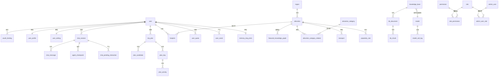

# 云游坊 - 数据库设计

> 本文档为设计第三阶段产出，基于 `docs/design/01.功能模块梳理.md` 与 `docs/design/02.整体架构设计.md`。
> 遵循 `docs/rules/database-rules.md` 的设计规范。
>
> 文档版本：v1.0
> 编写日期：2026-11-05
> 状态：待审核

---

## 一、设计原则

### 1.1 遵循的规范

| 规范项 | 本设计的落实 |
|--------|-------------|
| 命名使用 `snake_case` | 所有表名、字段名 |
| 表名统一单数 | 如 `user`、`attraction`（非 `users`） |
| 主键命名 `id` | 所有表统一 |
| 外键命名 `{实体}_id` | 如 `user_id`、`attraction_id` |
| 禁止物理外键 | 不使用 `FOREIGN KEY`，关系由应用层维护 |
| 主键唯一、非空、稳定 | **使用 UUIDv7** |
| 业务唯一值用唯一约束 | 如 `user.phone`、`attraction.name + city` |
| 金额用定点数 | `NUMERIC(12,2)` |
| 时间统一 UTC | 所有时间字段为 `TIMESTAMPTZ` |
| 状态字段取值有限可枚举 | 使用 `VARCHAR` + `CHECK` 约束 |
| 单个字段不拼接多值 | 需要多值时用关联表或 JSONB（明确约定结构） |

### 1.2 主键选型：UUIDv7

**决策**：所有表主键使用 `UUID` 类型，应用层生成 **UUIDv7**。

**理由**：

| 方案 | 优点 | 缺点 |
|------|------|------|
| 自增 BIGSERIAL | 索引紧凑、写入顺序友好 | 可被枚举爬取；分布式生成困难 |
| UUIDv4 | 随机、无规律 | 索引碎片化严重，写入性能差 |
| **UUIDv7** | 时间有序（前 48 位为毫秒时间戳），索引友好；不可枚举 | 存储占用 16 字节（略大于 8 字节） |

**采用 UUIDv7 的关键收益**：
- 对外暴露的 ID 不可枚举，避免景点、会话、计划的爬取与越权猜测
- 时间有序特性保证了 B-tree 索引的写入效率，避免 UUIDv4 的页分裂问题
- 无需区分「内部 ID」与「对外 ID」，简化模型

### 1.3 JSONB 的使用边界

规范允许「明确约定的结构化存储」。本设计在以下场景使用 JSONB：

| 表.字段 | 内容 | 为何用 JSONB |
|---------|------|-------------|
| `knowledge_base.separator_config` | 分隔符列表与优先级 | 结构可变，不需要单独查询 |
| `kb_document.indexed_meta` | 入库时的切分配置快照 | 仅用于对比展示，无需检索 |
| `chat_session.working_memory` | 行程规划的中间状态 | 结构随流程演进，无查询需求 |
| `agent_checkpoint.state` | LangGraph 图状态快照 | LangGraph 框架定义的结构 |
| `memory_long_term.value` | 偏好项的取值 | 类型多样（字符串/数值/数组） |
| `plan_candidate.content` | 方案完整快照 | 见 1.4 |
| `plan_day.budget_breakdown` | 当日预算明细 | 分类固定但数量不固定 |

**不使用 JSONB 的场景**：凡是需要按字段筛选、排序、统计的数据，一律拆为独立列或独立表。

### 1.4 行程方案的结构化决策

**已确认**：采用**结构化表**（问题 1 选 B），而非全 JSON 存储。

**理由**：数据看板需要统计「热门目的地城市排行」「平均计划天数」，足迹需要统计「去过的省份/城市数」，这些必须能从行程结构中高效查询。

**同时保留 JSONB 快照**：
- `plan_candidate.content` 存储方案的完整 JSON 快照，用于精确回放（用户切换备选方案时，可完整还原当时的方案）
- 结构化表 `plan_day` / `plan_activity` 存储可查询的行程骨架

两者的关系：`plan_candidate.content` 是「快照」，`plan_day`/`plan_activity` 是「当前生效的结构」。用户选定方案后，快照内容会展开写入结构化表。

---

## 二、实体关系总览



**说明**：图为逻辑关系，数据库中不建物理外键。所有 `||--o{` 关系均通过 `{实体}_id` 字段在应用层维护。

---

## 三、表结构设计

### 3.1 用户与账户（M01）

#### user — 用户主表

| 字段 | 类型 | 约束 | 说明 |
|------|------|------|------|
| id | UUID | PK | 主键，UUIDv7 |
| username | VARCHAR(50) | NOT NULL, UNIQUE | 用户名 |
| nickname | VARCHAR(50) | NOT NULL | 昵称 |
| avatar_url | VARCHAR(500) | NULL | 头像地址 |
| gender | VARCHAR(10) | NULL, CHECK IN ('male','female','secret') | 性别 |
| region_code | VARCHAR(20) | NULL | 常驻地区编码 |
| status | VARCHAR(20) | NOT NULL, DEFAULT 'active', CHECK IN ('active','banned','deleted') | 账号状态 |
| token_version | INTEGER | NOT NULL, DEFAULT 0 | Token 版本号 |
| last_login_at | TIMESTAMPTZ | NULL | 最后登录时间 |
| created_at | TIMESTAMPTZ | NOT NULL, DEFAULT NOW() | 创建时间 |
| updated_at | TIMESTAMPTZ | NOT NULL, DEFAULT NOW() | 更新时间 |

**索引**：
- `pk_user` (id) — 主键
- `uk_user_username` (username) UNIQUE
- `idx_user_status` (status)
- `idx_user_created_at` (created_at DESC) — 看板按时间统计

**`token_version` 的设计说明**：

用于实现**全端登出**，无需新增 Refresh Token 存储表。

```
JWT payload 携带 token_version
  ↓
每次鉴权比对：payload.token_version == user.token_version
  ↓
以下操作触发 token_version 自增：
  · 用户登出
  · 修改密码
  · 账号被封禁
  · 管理员强制下线
  ↓
所有已签发 Token 立即失效
```

**取舍**：不支持单端登出（多设备登录时，任一设备登出会导致全部退出）。若后续需要单端登出，需新增 Refresh Token 存储表。

**说明**：
- 手机号与邮箱不在此表，移至 `oauth_binding`（登录方式表），因需求确认「支持多种登录方式绑定同一账户」
- `status='deleted'` 为软删除标记，注销用户保留匿名化记录

---

#### oauth_binding — 登录方式绑定

| 字段 | 类型 | 约束 | 说明 |
|------|------|------|------|
| id | UUID | PK | 主键 |
| user_id | UUID | NOT NULL | 关联用户 |
| provider | VARCHAR(20) | NOT NULL, CHECK IN ('phone','email','wechat','alipay','weibo') | 登录方式 |
| provider_uid | VARCHAR(200) | NOT NULL | 第三方唯一标识（手机号/邮箱/openid） |
| credential | VARCHAR(255) | NULL | 密码哈希（仅 phone/email 使用，bcrypt） |
| extra_data | JSONB | NULL | 第三方附加信息（union_id、access_token 等） |
| is_primary | BOOLEAN | NOT NULL, DEFAULT FALSE | 是否主要登录方式 |
| created_at | TIMESTAMPTZ | NOT NULL, DEFAULT NOW() | 绑定时间 |

**索引**：
- `pk_oauth_binding` (id) — 主键
- `uk_oauth_provider_uid` (provider, provider_uid) UNIQUE — 防止同一方式重复绑定
- `idx_oauth_user_id` (user_id) — 查用户的登录方式

**说明**：
- `(provider, provider_uid)` 唯一约束保证同一手机号/邮箱不能被两个账号绑定
- `credential` 只对 phone/email 有值，第三方登录为 NULL

---

#### user_profile — 用户偏好档案

| 字段 | 类型 | 约束 | 说明 |
|------|------|------|------|
| id | UUID | PK | 主键 |
| user_id | UUID | NOT NULL, UNIQUE | 关联用户（一对一） |
| travel_types | JSONB | NULL | 旅游类型偏好，如 `["历史人文","自然风光"]` |
| travel_styles | JSONB | NULL | 旅行风格，如 `["深度游","家庭出游"]` |
| budget_level | VARCHAR(20) | NULL, CHECK IN ('economy','moderate','comfortable','luxury') | 预算等级 |
| companion_type | VARCHAR(20) | NULL, CHECK IN ('solo','couple','family','friends') | 常见同行类型 |
| preferred_seasons | JSONB | NULL | 偏好季节 |
| departure_city_code | VARCHAR(20) | NULL | 默认出发城市编码（GB/T 2260），与 `user.region_code` 同一套格式 |
| updated_at | TIMESTAMPTZ | NOT NULL, DEFAULT NOW() | 更新时间 |

**索引**：
- `pk_user_profile` (id) — 主键
- `uk_user_profile_user_id` (user_id) UNIQUE

**说明**：此表是用户**显式设置**的偏好（M01 个人中心可编辑）。由系统自动学习的长期记忆在 `memory_long_term` 表中，两者分离。

**地区字段统一存编码**（2026-11-09）：

| 字段 | 存什么 | 为什么 |
|---|---|---|
| `user.region_code` | 行政区划编码 | 稳定标识 |
| `user_profile.departure_city_code` | 行政区划编码 | 同上，与 `region_code` 统一 |

原 `departure_city` 存城市名称，运营在 B 端「省市管理」中改名后，
用户的偏好就再也匹配不上。编码（GB/T 2260）不会因改名而失效。

---

#### user_setting — 用户设置

| 字段 | 类型 | 约束 | 说明 |
|------|------|------|------|
| id | UUID | PK | 主键 |
| user_id | UUID | NOT NULL, UNIQUE | 关联用户 |
| profile_visibility | VARCHAR(20) | NOT NULL, DEFAULT 'public', CHECK IN ('public','friends','private') | 资料可见性 |
| footprint_visibility | VARCHAR(20) | NOT NULL, DEFAULT 'public', CHECK IN ('public','friends','private') | 足迹可见性 |
| plan_visibility | VARCHAR(20) | NOT NULL, DEFAULT 'public', CHECK IN ('public','friends','private') | 计划可见性 |
| allow_recommendation | BOOLEAN | NOT NULL, DEFAULT TRUE | 允许个性化推荐 |
| allow_notification | BOOLEAN | NOT NULL, DEFAULT TRUE | 接收通知 |
| updated_at | TIMESTAMPTZ | NOT NULL, DEFAULT NOW() | 更新时间 |

**索引**：
- `pk_user_setting` (id) — 主键
- `uk_user_setting_user_id` (user_id) UNIQUE

---

### 3.2 基础数据（M11）

#### region — 省市

| 字段 | 类型 | 约束 | 说明 |
|------|------|------|------|
| id | UUID | PK | 主键 |
| parent_id | UUID | NULL | 上级区域（省为 NULL） |
| name | VARCHAR(50) | NOT NULL | 区域名称 |
| level | SMALLINT | NOT NULL, CHECK IN (1,2) | 层级：1=省，2=市 |
| code | VARCHAR(20) | NOT NULL, UNIQUE | 行政区划编码 |
| description | TEXT | NULL | 简介 |
| cover_image_url | VARCHAR(500) | NULL | 封面图 |
| heat_score | NUMERIC(10,2) | NOT NULL, DEFAULT 0 | 热门度 |
| sort_weight | INTEGER | NOT NULL, DEFAULT 0 | 排序权重 |
| created_at | TIMESTAMPTZ | NOT NULL, DEFAULT NOW() | 创建时间 |
| updated_at | TIMESTAMPTZ | NOT NULL, DEFAULT NOW() | 更新时间 |

**索引**：
- `pk_region` (id) — 主键
- `uk_region_code` (code) UNIQUE
- `idx_region_parent_id` (parent_id) — 查下级城市
- `idx_region_level` (level)

---

#### attraction — 景点

| 字段 | 类型 | 约束 | 说明 |
|------|------|------|------|
| id | UUID | PK | 主键 |
| name | VARCHAR(100) | NOT NULL | 景点名称 |
| city_id | UUID | NOT NULL | 所属城市 |
| latitude | NUMERIC(10,7) | NULL | 纬度 |
| longitude | NUMERIC(10,7) | NULL | 经度 |
| address | VARCHAR(255) | NULL | 详细地址 |
| summary | VARCHAR(200) | NULL | 简介（100字） |
| description | TEXT | NULL | 详细介绍（富文本） |
| image_urls | JSONB | NULL | 图片地址列表 |
| ticket_price | NUMERIC(10,2) | NULL | 门票价格（元） |
| opening_hours | JSONB | NULL | 开放时间，如 `{"mon":"09:00-17:00"}` |
| visit_duration_minutes | INTEGER | NULL | 建议游玩时长（分钟） |
| best_seasons | JSONB | NULL | 最佳季节 |
| website | VARCHAR(500) | NULL | 官网 |
| phone | VARCHAR(50) | NULL | 联系电话 |
| traffic_guide | TEXT | NULL | 交通指南 |
| base_popularity | NUMERIC(10,2) | NOT NULL, DEFAULT 50 | 基础热度权重（运营配置，0-100） |
| is_published | BOOLEAN | NOT NULL, DEFAULT TRUE | 是否上架 |
| sort_weight | INTEGER | NOT NULL, DEFAULT 0 | 排序权重 |
| created_at | TIMESTAMPTZ | NOT NULL, DEFAULT NOW() | 创建时间 |
| updated_at | TIMESTAMPTZ | NOT NULL, DEFAULT NOW() | 更新时间 |

**索引**：
- `pk_attraction` (id) — 主键
- `uk_attraction_name_city` (name, city_id) UNIQUE — 同城景点名唯一
- `idx_attraction_city_id` (city_id)
- `idx_attraction_published` (is_published, sort_weight DESC)
- `idx_attraction_geo` (latitude, longitude) — 地理范围查询

**说明**：分类关系通过 `attraction_category_relation` 关联表维护，不在本表冗余。

---

#### attraction_category — 景点分类字典

| 字段 | 类型 | 约束 | 说明 |
|------|------|------|------|
| id | UUID | PK | 主键 |
| name | VARCHAR(50) | NOT NULL | 分类名称 |
| category_type | VARCHAR(20) | NOT NULL, CHECK IN ('theme','level') | 分类类型 |
| parent_id | UUID | NULL | 上级分类（支持二级） |
| description | VARCHAR(200) | NULL | 说明 |
| sort_weight | INTEGER | NOT NULL, DEFAULT 0 | 排序权重 |
| created_at | TIMESTAMPTZ | NOT NULL, DEFAULT NOW() | 创建时间 |
| updated_at | TIMESTAMPTZ | NOT NULL, DEFAULT NOW() | 更新时间 |

**索引**：
- `pk_attraction_category` (id) — 主键
- `uk_attr_cat_type_name` (category_type, name) UNIQUE — 同类型下名称唯一
- `idx_attr_cat_type` (category_type, sort_weight)
- `idx_attr_cat_parent` (parent_id)

**分类类型说明**：

| category_type | 含义 | 示例 |
|---|---|---|
| `theme` | 主题类型（内容属性） | 历史人文、自然景色、现代娱乐、美食街区 |
| `level` | 等级称号（官方评级） | 5A景区、4A景区、世界遗产 |

**为什么区分类型**：这两类语义不同——「历史人文」描述内容属性，「5A景区」是官方评级。前端做筛选时应分组展示，避免把「5A景区」和「历史人文」混在同一个筛选列表中。

---

#### attraction_category_relation — 景点分类关联

| 字段 | 类型 | 约束 | 说明 |
|------|------|------|------|
| id | UUID | PK | 主键 |
| attraction_id | UUID | NOT NULL | 景点 |
| category_id | UUID | NOT NULL | 分类 |
| created_at | TIMESTAMPTZ | NOT NULL, DEFAULT NOW() | 创建时间 |

**索引**：
- `pk_attraction_category_relation` (id) — 主键
- `uk_attr_cat_rel` (attraction_id, category_id) UNIQUE — 避免重复关联
- `idx_attr_cat_rel_attraction` (attraction_id)
- `idx_attr_cat_rel_category` (category_id) — 按分类查景点列表

**说明**：多对多关系，一个景点可属多个分类。

---

#### restaurant — 餐厅

| 字段 | 类型 | 约束 | 说明 |
|------|------|------|------|
| id | UUID | PK | 主键 |
| name | VARCHAR(100) | NOT NULL | 餐厅名称 |
| city_id | UUID | NOT NULL | 所属城市 |
| cuisine_type | VARCHAR(50) | NULL | 餐饮类型（中餐/西餐/火锅等） |
| latitude | NUMERIC(10,7) | NULL | 纬度 |
| longitude | NUMERIC(10,7) | NULL | 经度 |
| address | VARCHAR(255) | NULL | 详细地址 |
| summary | TEXT | NULL | 简介 |
| avg_cost | NUMERIC(10,2) | NULL | 人均消费 |
| business_hours | JSONB | NULL | 营业时间 |
| signature_dishes | JSONB | NULL | 特色菜列表 |
| image_urls | JSONB | NULL | 图片 |
| need_reservation | BOOLEAN | NOT NULL, DEFAULT FALSE | 是否需要预约 |
| phone | VARCHAR(50) | NULL | 联系电话 |
| is_published | BOOLEAN | NOT NULL, DEFAULT TRUE | 是否上架 |
| created_at | TIMESTAMPTZ | NOT NULL, DEFAULT NOW() | 创建时间 |
| updated_at | TIMESTAMPTZ | NOT NULL, DEFAULT NOW() | 更新时间 |

**索引**：
- `pk_restaurant` (id) — 主键
- `idx_restaurant_city_id` (city_id)
- `idx_restaurant_cuisine` (cuisine_type)
- `idx_restaurant_geo` (latitude, longitude)

---

#### hotel — 酒店

| 字段 | 类型 | 约束 | 说明 |
|------|------|------|------|
| id | UUID | PK | 主键 |
| name | VARCHAR(100) | NOT NULL | 酒店名称 |
| city_id | UUID | NOT NULL | 所属城市 |
| star_level | VARCHAR(20) | NULL | 星级（5星/4星/经济型等） |
| latitude | NUMERIC(10,7) | NULL | 纬度 |
| longitude | NUMERIC(10,7) | NULL | 经度 |
| address | VARCHAR(255) | NULL | 详细地址 |
| summary | TEXT | NULL | 简介 |
| min_price | NUMERIC(10,2) | NULL | 最低价 |
| max_price | NUMERIC(10,2) | NULL | 最高价 |
| room_types | JSONB | NULL | 房型列表 |
| facilities | JSONB | NULL | 设施列表 |
| image_urls | JSONB | NULL | 图片 |
| booking_url | VARCHAR(500) | NULL | 第三方预订链接 |
| phone | VARCHAR(50) | NULL | 联系电话 |
| is_published | BOOLEAN | NOT NULL, DEFAULT TRUE | 是否上架 |
| created_at | TIMESTAMPTZ | NOT NULL, DEFAULT NOW() | 创建时间 |
| updated_at | TIMESTAMPTZ | NOT NULL, DEFAULT NOW() | 更新时间 |

**索引**：
- `pk_hotel` (id) — 主键
- `idx_hotel_city_id` (city_id)
- `idx_hotel_star` (star_level)
- `idx_hotel_geo` (latitude, longitude)

---

#### transport — 景区交通

| 字段 | 类型 | 约束 | 说明 |
|------|------|------|------|
| id | UUID | PK | 主键 |
| attraction_id | UUID | NOT NULL | 关联景点 |
| name | VARCHAR(100) | NOT NULL | 交通工具名称（如「九寨沟观光车」） |
| transport_type | VARCHAR(50) | NULL | 类型（观光车/索道/缆车/船） |
| price | NUMERIC(10,2) | NULL | 价格 |
| description | TEXT | NULL | 说明 |
| operating_hours | JSONB | NULL | 运营时间 |
| created_at | TIMESTAMPTZ | NOT NULL, DEFAULT NOW() | 创建时间 |
| updated_at | TIMESTAMPTZ | NOT NULL, DEFAULT NOW() | 更新时间 |

**索引**：
- `pk_transport` (id) — 主键
- `idx_transport_attraction_id` (attraction_id)

**说明**：仅维护景区内专属交通。城际交通不入库，通过 MCP 工具实时查询。

---

#### popularity_stat — 热度统计

| 字段 | 类型 | 约束 | 说明 |
|------|------|------|------|
| id | UUID | PK | 主键 |
| attraction_id | UUID | NOT NULL, UNIQUE | 关联景点（一对一） |
| view_count | BIGINT | NOT NULL, DEFAULT 0 | 累计浏览量 |
| click_count | BIGINT | NOT NULL, DEFAULT 0 | 累计点击量 |
| plan_count | BIGINT | NOT NULL, DEFAULT 0 | 加入计划次数 |
| rating_sum | NUMERIC(12,2) | NOT NULL, DEFAULT 0 | 评分总和（用于计算均值） |
| rating_count | INTEGER | NOT NULL, DEFAULT 0 | 评分数 |
| behavior_score | NUMERIC(10,2) | NOT NULL, DEFAULT 0 | 行为得分（0-100） |
| final_popularity | NUMERIC(10,2) | NOT NULL, DEFAULT 50 | 最终热度值 |
| updated_at | TIMESTAMPTZ | NOT NULL, DEFAULT NOW() | 最后计算时间 |

**索引**：
- `pk_popularity_stat` (id) — 主键
- `uk_popularity_attraction` (attraction_id) UNIQUE
- `idx_popularity_final` (final_popularity DESC) — 首页排行榜

**说明**：`final_popularity = base_popularity × 0.6 + behavior_score × 0.4`，由定时任务计算写入。

---

### 3.3 知识库（M09）

#### knowledge_base — 知识库

| 字段 | 类型 | 约束 | 说明 |
|------|------|------|------|
| id | UUID | PK | 主键 |
| name | VARCHAR(100) | NOT NULL | 知识库名称 |
| description | TEXT | NULL | 描述 |
| icon | VARCHAR(50) | NULL | 图标标识 |
| capacity_gb | NUMERIC(10,2) | NOT NULL, DEFAULT 5 | 容量上限（GB） |
| used_bytes | BIGINT | NOT NULL, DEFAULT 0 | 已用空间（字节） |
| chunk_size | INTEGER | NOT NULL, DEFAULT 1024 | 切分块大小（字） |
| chunk_overlap | INTEGER | NOT NULL, DEFAULT 100 | 重叠长度（字） |
| separator_config | JSONB | NOT NULL | 分隔符配置，含启用状态与优先级 |
| retrieval_top_k | INTEGER | NOT NULL, DEFAULT 5 | 检索返回切片数 |
| retrieval_threshold | NUMERIC(4,3) | NOT NULL, DEFAULT 0.500 | 相似度阈值 |
| embedding_model_id | UUID | NOT NULL | 向量化模型 |
| rerank_model_id | UUID | NULL | 重排序模型（可空，不启用） |
| permission_scope | VARCHAR(20) | NOT NULL, DEFAULT 'all', CHECK IN ('all','specific') | 访问权限范围 |
| rebuild_status | VARCHAR(20) | NOT NULL, DEFAULT 'normal', CHECK IN ('normal','pending_rebuild','rebuilding') | 重建状态 |
| doc_count | INTEGER | NOT NULL, DEFAULT 0 | 文档数（冗余，便于列表展示） |
| created_by | UUID | NOT NULL | 创建者 |
| created_at | TIMESTAMPTZ | NOT NULL, DEFAULT NOW() | 创建时间 |
| updated_at | TIMESTAMPTZ | NOT NULL, DEFAULT NOW() | 更新时间 |

**索引**：
- `pk_knowledge_base` (id) — 主键
- `idx_kb_embedding_model` (embedding_model_id) — 删除模型时检查引用
- `idx_kb_rerank_model` (rerank_model_id) — 同上
- `idx_kb_rebuild_status` (rebuild_status) — 检索时过滤待重建的库

**说明**：
- `separator_config` 结构示例：
  ```json
  [
    {"key":"blank","label":"空行","value":"\n\n","enabled":true,"is_builtin":true},
    {"key":"custom_1","label":"第X章","value":"第","enabled":true,"is_builtin":false}
  ]
  ```
- `rebuild_status != 'normal'` 时，该知识库暂停参与检索（需求 2.2.5.5）

---

#### kb_document — 知识库文档

| 字段 | 类型 | 约束 | 说明 |
|------|------|------|------|
| id | UUID | PK | 主键 |
| knowledge_base_id | UUID | NOT NULL | 所属知识库 |
| file_name | VARCHAR(255) | NOT NULL | 原始文件名 |
| file_type | VARCHAR(20) | NOT NULL | 文件类型（pdf/docx/xlsx/txt/md/image/url） |
| file_size_bytes | BIGINT | NOT NULL | 文件大小 |
| storage_key | VARCHAR(500) | NOT NULL | MinIO 中的对象键 |
| source_url | VARCHAR(1000) | NULL | 网页链接来源（仅 URL 类型） |
| process_status | VARCHAR(20) | NOT NULL, DEFAULT 'queued', CHECK IN ('queued','parsing','chunking','embedding','success','failed') | 处理状态 |
| process_progress | SMALLINT | NOT NULL, DEFAULT 0, CHECK (process_progress BETWEEN 0 AND 100) | 进度百分比 |
| queue_position | INTEGER | NULL | 排队位置 |
| error_message | TEXT | NULL | 失败原因 |
| retry_count | INTEGER | NOT NULL, DEFAULT 0 | 重试次数 |
| markdown_content | TEXT | NULL | 归一化后的 Markdown |
| chunk_count | INTEGER | NULL | 切片数量 |
| page_count | INTEGER | NULL | 原始页数 |
| indexed_meta | JSONB | NULL | 入库时的切分配置快照，如 `{"chunk_size":1024,"chunk_overlap":100}` |
| es_indexed | BOOLEAN | NOT NULL, DEFAULT FALSE | ES 是否已索引 |
| milvus_indexed | BOOLEAN | NOT NULL, DEFAULT FALSE | Milvus 是否已写入 |
| task_id | VARCHAR(100) | NULL | Celery 任务 ID |
| uploaded_by | UUID | NOT NULL | 上传者 |
| created_at | TIMESTAMPTZ | NOT NULL, DEFAULT NOW() | 上传时间 |
| updated_at | TIMESTAMPTZ | NOT NULL, DEFAULT NOW() | 更新时间 |

**索引**：
- `pk_kb_document` (id) — 主键
- `idx_kbdoc_kb_id` (knowledge_base_id, created_at DESC)
- `idx_kbdoc_status` (process_status) — 查处理中的文档
- `idx_kbdoc_task` (task_id) — 按任务反查

**说明**：
- `es_indexed` 与 `milvus_indexed` 支持双写部分失败时的状态跟踪
- `indexed_meta` 用于识别「旧参数文档」（需求 2.2.4.5）

---

#### kb_chunk — 文档切片

| 字段 | 类型 | 约束 | 说明 |
|------|------|------|------|
| id | UUID | PK | 主键 |
| document_id | UUID | NOT NULL | 所属文档 |
| knowledge_base_id | UUID | NOT NULL | 所属知识库（冗余，便于按库查询） |
| chunk_index | INTEGER | NOT NULL | 切片序号（从 1 开始） |
| heading_path | VARCHAR(500) | NULL | 标题路径，如「第三章 > 3.2 太和殿」 |
| content | TEXT | NOT NULL | 切片文本 |
| char_count | INTEGER | NOT NULL | 字符数 |
| milvus_vector_id | VARCHAR(100) | NULL | Milvus 中的向量 ID |
| es_doc_id | VARCHAR(100) | NULL | ES 中的文档 ID |
| created_at | TIMESTAMPTZ | NOT NULL, DEFAULT NOW() | 创建时间 |

**索引**：
- `pk_kb_chunk` (id) — 主键
- `uk_kbchunk_doc_index` (document_id, chunk_index) UNIQUE
- `idx_kbchunk_kb_id` (knowledge_base_id)
- `idx_kbchunk_milvus` (milvus_vector_id)

**说明**：
- PG 中的 `kb_chunk` 是**切片的源数据**，Milvus 存向量，ES 存索引副本
- 删除文档时需级联清理 Milvus 与 ES 中的对应数据（应用层保证）

---

### 3.4 知识图谱（M10）

**设计要点**：Neo4j 存图谱结构与节点名称；PG 存实体详情。

#### kg_person — 历史人物

| 字段 | 类型 | 约束 | 说明 |
|------|------|------|------|
| id | UUID | PK | 主键 |
| name | VARCHAR(100) | NOT NULL | 姓名 |
| alias | VARCHAR(200) | NULL | 别名 |
| dynasty | VARCHAR(50) | NULL | 朝代 |
| occupation | VARCHAR(100) | NULL | 职业 |
| birth_year | INTEGER | NULL | 出生年 |
| death_year | INTEGER | NULL | 卒年 |
| hometown | VARCHAR(100) | NULL | 籍贯 |
| representative_works | JSONB | NULL | 代表作 |
| summary | TEXT | NULL | 简介 |
| image_url | VARCHAR(500) | NULL | 画像地址 |
| graph_sync_status | VARCHAR(20) | NOT NULL, DEFAULT 'synced', CHECK IN ('pending','synced','failed') | Neo4j 同步状态 |
| graph_sync_error | TEXT | NULL | 最后同步失败原因，成功后清空 |
| created_at | TIMESTAMPTZ | NOT NULL, DEFAULT NOW() | 创建时间 |
| updated_at | TIMESTAMPTZ | NOT NULL, DEFAULT NOW() | 更新时间 |

**索引**：
- `pk_kg_person` (id) — 主键
- `idx_kgperson_name` (name)
- `idx_kgperson_sync` (graph_sync_status) WHERE graph_sync_status != 'synced' — 查待同步/失败的记录

---

#### kg_event — 历史事件

| 字段 | 类型 | 约束 | 说明 |
|------|------|------|------|
| id | UUID | PK | 主键 |
| name | VARCHAR(200) | NOT NULL | 事件名称 |
| event_time | VARCHAR(100) | NULL | 发生时间（可含朝代纪年） |
| location | VARCHAR(200) | NULL | 发生地点 |
| event_type | VARCHAR(50) | NULL | 事件类型 |
| significance | TEXT | NULL | 历史意义 |
| description | TEXT | NULL | 详细描述 |
| graph_sync_status | VARCHAR(20) | NOT NULL, DEFAULT 'synced', CHECK IN ('pending','synced','failed') | Neo4j 同步状态 |
| graph_sync_error | TEXT | NULL | 最后同步失败原因，成功后清空 |
| created_at | TIMESTAMPTZ | NOT NULL, DEFAULT NOW() | 创建时间 |
| updated_at | TIMESTAMPTZ | NOT NULL, DEFAULT NOW() | 更新时间 |

**索引**：
- `pk_kg_event` (id) — 主键
- `idx_kgevent_name` (name)
- `idx_kgevent_sync` (graph_sync_status) WHERE graph_sync_status != 'synced'

**说明**：`event_time` 用字符串而非 DATE，因历史事件常以「永乐十八年」等纪年表示，无法统一为公历日期。

---

#### kg_culture — 文化元素

| 字段 | 类型 | 约束 | 说明 |
|------|------|------|------|
| id | UUID | PK | 主键 |
| name | VARCHAR(100) | NOT NULL | 名称 |
| culture_type | VARCHAR(50) | NULL, CHECK IN ('architecture','art','folklore','specialty') | 类型：建筑风格/艺术形式/民俗活动/地方特产 |
| region | VARCHAR(100) | NULL | 所属地区 |
| description | TEXT | NULL | 特点描述 |
| image_url | VARCHAR(500) | NULL | 图片 |
| graph_sync_status | VARCHAR(20) | NOT NULL, DEFAULT 'synced', CHECK IN ('pending','synced','failed') | Neo4j 同步状态 |
| graph_sync_error | TEXT | NULL | 最后同步失败原因，成功后清空 |
| created_at | TIMESTAMPTZ | NOT NULL, DEFAULT NOW() | 创建时间 |
| updated_at | TIMESTAMPTZ | NOT NULL, DEFAULT NOW() | 更新时间 |

**索引**：
- `pk_kg_culture` (id) — 主键
- `idx_kgculture_type` (culture_type)
- `idx_kgculture_sync` (graph_sync_status) WHERE graph_sync_status != 'synced'

---

#### kg_relation_type — 关系类型

| 字段 | 类型 | 约束 | 说明 |
|------|------|------|------|
| id | UUID | PK | 主键 |
| code | VARCHAR(50) | NOT NULL, UNIQUE | 类型编码，如 `built_by` |
| name | VARCHAR(50) | NOT NULL | 显示名，如「建造者」 |
| cardinality | VARCHAR(20) | NOT NULL, CHECK IN ('one_to_one','many_to_many') | 基数约束 |
| source_types | JSONB | NOT NULL | 允许的起始实体类型，如 `["attraction"]` |
| target_types | JSONB | NOT NULL | 允许的目标实体类型，如 `["person"]` |
| is_builtin | BOOLEAN | NOT NULL, DEFAULT TRUE | 是否内置 |
| description | VARCHAR(200) | NULL | 说明 |
| created_at | TIMESTAMPTZ | NOT NULL, DEFAULT NOW() | 创建时间 |

**索引**：
- `pk_kg_relation_type` (id) — 主键
- `uk_kgreltype_code` (code) UNIQUE

**说明**：`cardinality` 决定是否允许重复关系（需求确认：一对一不允许重复，多对多允许）。此表为**关系类型的元数据**，实际关系存储在 Neo4j。

---

#### 图谱实体与 Neo4j 的同步策略

**已确认：PG 优先，Neo4j 异步补偿**

三张实体表（`kg_person` / `kg_event` / `kg_culture`）通过 `graph_sync_status` 字段跟踪同步状态。

**状态定义**：

| 状态 | 含义 | 界面表现 |
|------|------|---------|
| `pending` | 待同步（PG 已写入，Neo4j 尚未完成） | B 端列表显示「同步中」黄色标记 |
| `synced` | 已同步 | 正常显示 |
| `failed` | 同步失败（重试 3 次仍失败） | B 端列表显示「同步失败」红色标记，并提供 `graph_sync_error` 中的失败原因与「重试」按钮 |

**`graph_sync_error` 字段**：记录最后一次同步失败的原因（如「Neo4j 连接超时」「节点 ID 冲突」），同步成功后清空。便于运营自助排查，无需查服务端日志。

**写入流程**：

```
创建 / 更新 / 删除实体
  ↓
1. 写 PG（事务提交，graph_sync_status='pending'）
  ↓
2. 返回响应给调用方（不等待 Neo4j）
  ↓
3. 投递 Celery 任务
  ↓
4. Worker 写 Neo4j
  ├─ 成功 → graph_sync_status='synced'
  └─ 失败 → 重试 3 次（1s / 5s / 30s 指数退避）
              ↓
          仍失败 → graph_sync_status='failed' + 告警管理员
  ↓
5. 每日 00:30 全量对账，修复不一致
```

**为什么不采用同步双写**：
- PG 是权威数据源，业务写入应以 PG 为准
- Neo4j 暂时不可用时业务不应受阻
- 与「名称修改异步同步」的既有策略保持一致

**代价**：创建实体后立即查看图谱页，可能几秒内看不到（同步窗口）。

**手动重试**：B 端提供接口 `POST /admin/knowledge-graph/entities/{type}/{id}/sync` 触发重新同步。

---

#### featured_knowledge_graph — 发现页精选图谱

| 字段 | 类型 | 约束 | 说明 |
|------|------|------|------|
| id | UUID | PK | 主键 |
| attraction_id | UUID | NOT NULL, UNIQUE | 被精选的景点 |
| sort_weight | INTEGER | NOT NULL, DEFAULT 0 | 排序权重，越大越靠前 |
| created_by | UUID | NOT NULL | 配置人 |
| created_at | TIMESTAMPTZ | NOT NULL, DEFAULT NOW() | 创建时间 |

**索引**：
- `pk_featured_knowledge_graph` (id) — 主键
- `uk_fkg_attraction` (attraction_id) UNIQUE — 同一景点不可重复精选
- `idx_fkg_sort` (sort_weight DESC) — 按权重排序

**设计说明**：

| 决策 | 理由 |
|---|---|
| **独立表而非在 `attraction` 加布尔字段** | 需要控制展示**顺序**（谁排第一），布尔字段无法表达；且「是否上发现页」只与部分景点相关，独立表不污染景点主表 |
| **不做级联删除** | 景点被删除时应同步移除精选记录，由应用层在删除景点时检查并清理 |

**发现页查询**：

```sql
SELECT a.*, f.sort_weight
FROM featured_knowledge_graph f
JOIN attraction a ON f.attraction_id = a.id
WHERE a.is_published = TRUE
ORDER BY f.sort_weight DESC
LIMIT 6;
```

---

### 3.5 对话与 Agent（M03、M06、M07）

#### chat_session — 会话

| 字段 | 类型 | 约束 | 说明 |
|------|------|------|------|
| id | UUID | PK | 主键 |
| user_id | UUID | NOT NULL | 所属用户 |
| title | VARCHAR(200) | NOT NULL, DEFAULT '新对话' | 会话标题（取首条用户消息） |
| current_model_id | UUID | NULL | 当前会话使用的文本模型（可切换） |
| current_intent | VARCHAR(50) | NULL | 当前意图 |
| flow_state | VARCHAR(50) | NULL | 流程状态（如 `collecting_requirements`） |
| working_memory | JSONB | NULL | 工作记忆（候选景点、已生成方案等中间状态） |
| message_count | INTEGER | NOT NULL, DEFAULT 0 | 消息数（冗余） |
| last_active_at | TIMESTAMPTZ | NOT NULL, DEFAULT NOW() | 最后活跃时间 |
| created_at | TIMESTAMPTZ | NOT NULL, DEFAULT NOW() | 创建时间 |
| updated_at | TIMESTAMPTZ | NOT NULL, DEFAULT NOW() | 更新时间 |

**索引**：
- `pk_chat_session` (id) — 主键
- `idx_chatsession_user` (user_id, last_active_at DESC) — 会话列表
- `idx_chatsession_active` (last_active_at DESC)

**说明**：
- `working_memory` 存行程规划的中间状态（候选景点、方案草稿、调整历史），结构随流程演进，用 JSONB
- `current_model_id` 实现「会话级模型切换」，新会话恢复为平台默认

---

#### chat_message — 对话消息

| 字段 | 类型 | 约束 | 说明 |
|------|------|------|------|
| id | UUID | PK | 主键 |
| session_id | UUID | NOT NULL | 所属会话 |
| role | VARCHAR(20) | NOT NULL, CHECK IN ('user','assistant','system','tool') | 角色 |
| content | TEXT | NOT NULL | 消息内容 |
| content_type | VARCHAR(20) | NOT NULL, DEFAULT 'text', CHECK IN ('text','markdown','plan_card','clarify_options') | 内容类型 |
| tool_calls | JSONB | NULL | 工具调用记录（仅 assistant） |
| citations | JSONB | NULL | 引用来源 |
| model_id | UUID | NULL | 生成该消息的模型 |
| token_input | INTEGER | NULL | 输入 token 数 |
| token_output | INTEGER | NULL | 输出 token 数 |
| latency_ms | INTEGER | NULL | 响应延迟 |
| created_at | TIMESTAMPTZ | NOT NULL, DEFAULT NOW() | 创建时间 |

**索引**：
- `pk_chat_message` (id) — 主键
- `idx_chatmsg_session` (session_id, created_at ASC) — 按时间顺序取消息链
- `idx_chatmsg_created` (created_at DESC) — 按时间清理/归档

**说明**：
- `content_type='plan_card'` 时，`content` 存方案卡片的结构化数据
- `tool_calls` 记录工具调用轨迹，用于来源追溯与调试（也可从 Langfuse 获取，此处保留业务视角）
- 消息量级预估：1000 用户 × 10 会话 × 20 轮 = 20 万行，单表可承载
- **不分区**：会话消息属业务数据，用户会长期回看（需求支持「中断后回来无缝继续」），无批量清理需求

---

#### chat_pending_interaction — 待处理交互

| 字段 | 类型 | 约束 | 说明 |
|------|------|------|------|
| id | UUID | PK | 主键 |
| session_id | UUID | NOT NULL | 所属会话 |
| interaction_type | VARCHAR(50) | NOT NULL, CHECK IN ('requirements','plan_selection','intent_clarify','adjustment_confirm') | 交互类型 |
| payload | JSONB | NOT NULL | 交互内容（选项、缺失字段、自定义输入提示） |
| status | VARCHAR(20) | NOT NULL, DEFAULT 'pending', CHECK IN ('pending','answered','expired','cancelled') | 状态 |
| answer | JSONB | NULL | 用户选择结果 |
| expires_at | TIMESTAMPTZ | NULL | 过期时间 |
| answered_at | TIMESTAMPTZ | NULL | 回答时间 |
| created_at | TIMESTAMPTZ | NOT NULL, DEFAULT NOW() | 创建时间 |

**索引**：
- `pk_chat_pending_interaction` (id) — 主键
- `idx_cpi_session` (session_id, status) — 查会话的待处理项
- `idx_cpi_pending` (status, created_at DESC) WHERE status = 'pending' — 查全局待处理项
- `uk_cpi_session_pending` (session_id) WHERE status = 'pending' — **同一会话同时只允许一个待处理交互**

**交互类型说明**：

| interaction_type | 场景 | payload 示例 |
|---|---|---|
| `requirements` | 行程规划信息收集，缺少必要字段 | `{"missing":["budget"],"prompt":"您的预算大概多少？"}` |
| `plan_selection` | 展示 2-3 个方案，等待用户选择 | `{"candidates":[{"id":"...","type":"standard","title":"标准型","budget":3000}]}` |
| `intent_clarify` | 意图识别置信度低于阈值 | `{"options":[{"intent":"attraction_query","label":"了解景点"}],"allow_custom":true}` |
| `adjustment_confirm` | 方案调整后的保存确认 | `{"options":[{"action":"save_as_new","label":"保存为新方案"},{"action":"overwrite","label":"覆盖原方案"}]}` |

**为什么需要这张表**：

SSE 是传输通道而非状态载体。用户可能在 Agent 等待选择时关闭页面、网络断开或连接超时。若不落库，此时候选方案、待选选项就全部丢失。

落库后：
- 用户重新打开会话 → 查询到 `status='pending'` 的记录 → 直接展示选择框
- 后端的 Agent 流程可从 `agent_checkpoint` 恢复到等待点
- SSE 连接断开不影响业务状态

**与 `agent_checkpoint` 的分工**：

| 表 | 职责 |
|---|---|
| `agent_checkpoint` | LangGraph 的图执行状态快照（节点、变量、下一步），供断点续跑 |
| `chat_pending_interaction` | 面向用户的交互语义（选什么、缺什么），供前端渲染与用户操作 |

前者是框架层的技术状态，后者是业务层的交互状态。两者配合使用。

---

#### agent_checkpoint — LangGraph 检查点

| 字段 | 类型 | 约束 | 说明 |
|------|------|------|------|
| id | UUID | PK | 主键 |
| session_id | UUID | NOT NULL | 所属会话 |
| thread_id | VARCHAR(100) | NOT NULL | LangGraph 的 thread_id |
| checkpoint_id | VARCHAR(100) | NOT NULL | 检查点标识 |
| parent_checkpoint_id | VARCHAR(100) | NULL | 父检查点（用于回溯） |
| state | JSONB | NOT NULL | 图状态快照 |
| metadata | JSONB | NULL | 元数据（节点名、下一步等） |
| created_at | TIMESTAMPTZ | NOT NULL, DEFAULT NOW() | 创建时间 |

**索引**：
- `pk_agent_checkpoint` (id) — 主键
- `idx_agentcp_thread` (thread_id, created_at DESC)
- `uk_agentcp_thread_checkpoint` (thread_id, checkpoint_id) UNIQUE
- `idx_agentcp_session` (session_id)

**说明**：
- 供 LangGraph 的 PostgresSaver 使用，实现中断恢复
- `thread_id` 与 `session_id` 一对一映射，但保留独立字段以适配框架约定
- 检查点数据增长快，建议定期清理（如保留最近 7 天）

---

#### memory_long_term — 长期记忆

| 字段 | 类型 | 约束 | 说明 |
|------|------|------|------|
| id | UUID | PK | 主键 |
| user_id | UUID | NOT NULL | 所属用户 |
| memory_type | VARCHAR(50) | NOT NULL, CHECK IN ('preference','behavior','context') | 记忆类型 |
| memory_key | VARCHAR(100) | NOT NULL | 记忆项标识，如 `travel_type`、`budget_level` |
| memory_value | JSONB | NOT NULL | 记忆值 |
| confidence | NUMERIC(4,3) | NOT NULL, DEFAULT 1.000 | 采集时的置信度（0-1），不随时间改变；实际权重在读取时惰性计算 |
| source | VARCHAR(50) | NULL | 来源（conversation/footprint/plan/rating） |
| last_active_at | TIMESTAMPTZ | NOT NULL, DEFAULT NOW() | 最近激活时间（用于衰减计算） |
| created_at | TIMESTAMPTZ | NOT NULL, DEFAULT NOW() | 创建时间 |
| updated_at | TIMESTAMPTZ | NOT NULL, DEFAULT NOW() | 更新时间 |

**索引**：
- `pk_memory_long_term` (id) — 主键
- `uk_memory_user_key` (user_id, memory_type, memory_key) UNIQUE
- `idx_memory_user` (user_id)
- `idx_memory_active` (last_active_at DESC) — 按活跃时间排序

**说明**：
- 采用**键值行**而非单行 JSON，便于按记忆项独立更新
- 与 `user_profile` 的区别：`user_profile` 是用户显式设置的偏好，`memory_long_term` 是系统学习的推断

---

#### 记忆衰减算法

**已确认方案：惰性计算 + 指数衰减，半衰期 90 天**

**存储的 `confidence` 不随时间的流逝而改变**，它是「该记忆项被采集时的置信度」。实际权重在**读取时实时计算**：

```
当前权重 = confidence × 0.5 ^ (距 last_active_at 的天数 / 90)
```

**衰减曲线参考**：

| 距上次激活 | 衰减因子 | 若 confidence=1.0 时的权重 |
|---|---|---|
| 0 天 | 1.000 | 1.000 |
| 30 天 | 0.794 | 0.794 |
| 90 天 | 0.500 | 0.500 |
| 180 天 | 0.250 | 0.250 |
| 365 天 | 0.060 | 0.060 |

**为什么选惰性计算（不存衰减后的值）**：

| 对比项 | 惰性计算 | 定时任务更新 |
|---|---|---|
| 准确性 | 永远准确，与当前时间实时对齐 | 任务漏跑则权重失真 |
| 定时任务依赖 | 无 | 强依赖 |
| 写入开销 | 仅在实际产生新记忆时写 | 每日全表更新 |
| 排序查询 | 无法直接 SQL 按权重排序 | 可直接排序 |

**关键取舍**：牺牲「SQL 直接按权重排序」的能力。但记忆读取的场景是「会话开始时全量加载该用户的所有记忆」（需求已确认），单用户记忆项通常在几十条以内，在应用层排序完全可行。

**为什么选指数衰减而非线性**：

- 符合人类偏好演变规律：越久远的偏好越不可靠，但不会突然失效
- 半衰期 90 天与旅游偏好的实际变化周期匹配（季度级）
- 一年前的偏好仍保留 6% 权重，可作为无新数据时的兜底参考

**业务含义**：
- 3 个月前的偏好权重 50%，仍显著影响推荐
- 6 个月前的偏好权重 25%，作为辅助参考
- 1 年前的偏好权重 6%，仅在无新数据时兜底

---

### 3.6 旅游计划（M04）

#### trip_plan — 旅游计划

| 字段 | 类型 | 约束 | 说明 |
|------|------|------|------|
| id | UUID | PK | 主键 |
| user_id | UUID | NOT NULL | 所属用户 |
| title | VARCHAR(200) | NOT NULL | 计划标题 |
| destination_city_id | UUID | NULL | 目的地城市 |
| destination_text | VARCHAR(200) | NOT NULL | 目的地文本（支持多目的地串联） |
| start_date | DATE | NULL | 出发日期 |
| end_date | DATE | NULL | 结束日期 |
| day_count | INTEGER | NULL | 天数 |
| budget_per_person | NUMERIC(12,2) | NULL | 人均预算 |
| people_count | INTEGER | NOT NULL, DEFAULT 1 | 同行人数 |
| status | VARCHAR(20) | NOT NULL, DEFAULT 'planning', CHECK IN ('planning','pending','ongoing','completed','cancelled') | 状态 |
| selected_candidate_id | UUID | NULL | 选中的方案 |
| edit_lock_user | UUID | NULL | 编辑锁持有者（并发编辑控制） |
| edit_lock_at | TIMESTAMPTZ | NULL | 加锁时间 |
| confirmed_at | TIMESTAMPTZ | NULL | 确认时间 |
| completed_at | TIMESTAMPTZ | NULL | 完成时间 |
| created_at | TIMESTAMPTZ | NOT NULL, DEFAULT NOW() | 创建时间 |
| updated_at | TIMESTAMPTZ | NOT NULL, DEFAULT NOW() | 更新时间 |

**索引**：
- `pk_trip_plan` (id) — 主键
- `idx_tripplan_user_status` (user_id, status, created_at DESC) — 计划列表
- `idx_tripplan_status_dates` (status, start_date, end_date) — 定时任务扫状态流转
- `idx_tripplan_destination` (destination_city_id) — 热门目的地统计

**说明**：
- `edit_lock_user` + `edit_lock_at` 实现需求确认的「编辑锁定」：同一行程同时只允许一个会话编辑，锁超时自动释放
- `destination_text` 与 `destination_city_id` 并存：前者支持「北京+天津」这类文本，后者用于统计
- 无 `content` JSONB 字段——方案内容在 `plan_candidate` 中

---

#### plan_candidate — 方案候选

| 字段 | 类型 | 约束 | 说明 |
|------|------|------|------|
| id | UUID | PK | 主键 |
| plan_id | UUID | NOT NULL | 所属计划 |
| candidate_type | VARCHAR(20) | NOT NULL, CHECK IN ('economy','standard','comfort','custom') | 方案类型 |
| title | VARCHAR(200) | NOT NULL | 方案标题 |
| total_budget | NUMERIC(12,2) | NOT NULL | 总预算 |
| attraction_count | INTEGER | NOT NULL, DEFAULT 0 | 景点数 |
| accommodation_level | VARCHAR(50) | NULL | 住宿标准 |
| transport_level | VARCHAR(50) | NULL | 交通标准 |
| dining_level | VARCHAR(50) | NULL | 餐饮标准 |
| recommend_score | NUMERIC(4,2) | NULL | 推荐评分（0-5） |
| is_selected | BOOLEAN | NOT NULL, DEFAULT FALSE | 是否被选中 |
| is_active | BOOLEAN | NOT NULL, DEFAULT TRUE | 是否为当前生效方案 |
| content | JSONB | NOT NULL | 方案完整快照 |
| generated_by_session | UUID | NULL | 生成该方案的会话 |
| created_at | TIMESTAMPTZ | NOT NULL, DEFAULT NOW() | 创建时间 |
| updated_at | TIMESTAMPTZ | NOT NULL, DEFAULT NOW() | 更新时间 |

**索引**：
- `pk_plan_candidate` (id) — 主键
- `idx_plancand_plan` (plan_id, is_active, created_at DESC)
- `idx_plancand_selected` (plan_id, is_selected)

**说明**：
- 未选中方案保留为「备选」（需求确认），通过 `is_active=false` 区分
- `content` JSONB 存完整方案快照，用于精确回放
- 结构化字段（total_budget、attraction_count 等）用于方案对比表的快速查询

---

#### plan_day — 计划日程

| 字段 | 类型 | 约束 | 说明 |
|------|------|------|------|
| id | UUID | PK | 主键 |
| plan_id | UUID | NOT NULL | 所属计划 |
| candidate_id | UUID | NOT NULL | 所属方案 |
| day_number | INTEGER | NOT NULL | 第几天（从 1 开始） |
| date | DATE | NULL | 具体日期 |
| budget_breakdown | JSONB | NULL | 当日预算明细，如 `{"ticket":420,"dining":850}` |
| summary | TEXT | NULL | 当日概述 |
| created_at | TIMESTAMPTZ | NOT NULL, DEFAULT NOW() | 创建时间 |
| updated_at | TIMESTAMPTZ | NOT NULL, DEFAULT NOW() | 更新时间 |

**索引**：
- `pk_plan_day` (id) — 主键
- `uk_planday_cand_day` (candidate_id, day_number) UNIQUE
- `idx_planday_plan` (plan_id)

**说明**：日程挂在 `candidate_id` 下（而非 `plan_id`），因为不同方案的天数安排可能不同。

---

#### plan_activity — 行程活动

| 字段 | 类型 | 约束 | 说明 |
|------|------|------|------|
| id | UUID | PK | 主键 |
| plan_day_id | UUID | NOT NULL | 所属日程 |
| activity_type | VARCHAR(20) | NOT NULL, CHECK IN ('attraction','dining','transport','accommodation','rest') | 活动类型 |
| start_time | TIME | NULL | 开始时间 |
| end_time | TIME | NULL | 结束时间 |
| title | VARCHAR(200) | NOT NULL | 活动标题 |
| description | TEXT | NULL | 描述 |
| attraction_id | UUID | NULL | 关联景点（type=attraction 时） |
| restaurant_id | UUID | NULL | 关联餐厅（type=dining 时） |
| hotel_id | UUID | NULL | 关联酒店（type=accommodation 时） |
| cost | NUMERIC(10,2) | NULL | 费用 |
| sort_order | INTEGER | NOT NULL, DEFAULT 0 | 当天内的排序 |
| created_at | TIMESTAMPTZ | NOT NULL, DEFAULT NOW() | 创建时间 |
| updated_at | TIMESTAMPTZ | NOT NULL, DEFAULT NOW() | 更新时间 |

**索引**：
- `pk_plan_activity` (id) — 主键
- `idx_planact_day` (plan_day_id, sort_order)
- `idx_planact_attraction` (attraction_id) — 统计「被加入计划的次数」

**说明**：`attraction_id` 的索引支撑看板统计「热门景点」（按加入计划次数）。

---

### 3.7 足迹（M05）

#### footprint — 足迹

| 字段 | 类型 | 约束 | 说明 |
|------|------|------|------|
| id | UUID | PK | 主键 |
| user_id | UUID | NOT NULL | 所属用户 |
| attraction_id | UUID | NOT NULL | 关联景点 |
| visit_date | DATE | NOT NULL | 游览日期 |
| source | VARCHAR(20) | NOT NULL, CHECK IN ('auto_from_plan','manual') | 来源 |
| trip_plan_id | UUID | NULL | 关联计划（自动生成时） |
| rating | SMALLINT | NULL, CHECK (rating BETWEEN 1 AND 5) | 评分 |
| review | TEXT | NULL | 游记 |
| image_urls | JSONB | NULL | 照片地址列表 |
| is_public | BOOLEAN | NOT NULL, DEFAULT TRUE | 是否公开（供发现页推荐） |
| created_at | TIMESTAMPTZ | NOT NULL, DEFAULT NOW() | 创建时间 |
| updated_at | TIMESTAMPTZ | NOT NULL, DEFAULT NOW() | 更新时间 |

**索引**：
- `pk_footprint` (id) — 主键
- `idx_footprint_user` (user_id, visit_date DESC) — 足迹列表
- `idx_footprint_attraction` (attraction_id) — 景点评分聚合
- `idx_footprint_public` (is_public, created_at DESC) — 发现页精选

**说明**：
- 「走过的省份/城市数」通过 `footprint JOIN attraction JOIN region` 统计，不冗余
- `is_public` 支撑发现页「运营精选游记」

---

### 3.8 模型与额度（M12、M13）

#### model — 模型注册

| 字段 | 类型 | 约束 | 说明 |
|------|------|------|------|
| id | UUID | PK | 主键 |
| name | VARCHAR(100) | NOT NULL | 显示名称 |
| category | VARCHAR(20) | NOT NULL, CHECK IN ('chat','vision','embedding','rerank','ocr') | 模型类别 |
| model_code | VARCHAR(100) | NOT NULL | 调用模型 ID（如 `deepseek-chat`） |
| base_url | VARCHAR(500) | NOT NULL | 接口地址 |
| api_key_encrypted | TEXT | NULL | 加密后的 API Key |
| max_context_tokens | INTEGER | NULL | 最大上下文长度 |
| max_output_tokens | INTEGER | NULL | 单次最大输出 |
| timeout_seconds | INTEGER | NOT NULL, DEFAULT 60 | 超时时间 |
| concurrency_limit | INTEGER | NULL | 并发上限 |
| price_input | NUMERIC(12,6) | NULL | 输入单价（元/千 token） |
| price_output | NUMERIC(12,6) | NULL | 输出单价（元/千 token） |
| description | TEXT | NULL | 描述 |
| is_enabled | BOOLEAN | NOT NULL, DEFAULT TRUE | 是否启用 |
| is_default | BOOLEAN | NOT NULL, DEFAULT FALSE | 是否该类别的默认模型 |
| last_test_at | TIMESTAMPTZ | NULL | 最后连通性测试时间 |
| last_test_ok | BOOLEAN | NULL | 最后测试结果 |
| created_at | TIMESTAMPTZ | NOT NULL, DEFAULT NOW() | 创建时间 |
| updated_at | TIMESTAMPTZ | NOT NULL, DEFAULT NOW() | 更新时间 |

**索引**：
- `pk_model` (id) — 主键
- `uk_model_category_code` (category, model_code, base_url) UNIQUE — 同类别下不可重复注册
- `idx_model_category` (category, is_enabled)
- `idx_model_default` (category, is_default) WHERE is_default = TRUE — 每类只有一个默认

**说明**：
- **无 `vector_dim` 字段**——维度由配置文件控制（需求 2.2.5.2 已确认）
- `api_key_encrypted` 存储加密后的密钥，应用层解密使用
- 部分唯一索引 `WHERE is_default = TRUE` 保证每类别最多一个默认

---

#### model_call_log — 模型调用日志

| 字段 | 类型 | 约束 | 说明 |
|------|------|------|------|
| id | UUID | PK | 主键 |
| model_id | UUID | NOT NULL | 调用的模型 |
| caller_type | VARCHAR(20) | NOT NULL, CHECK IN ('user_chat','system_document') | 调用来源 |
| user_id | UUID | NULL | 用户 ID（caller_type=user_chat 时） |
| session_id | UUID | NULL | 会话 ID |
| document_id | UUID | NULL | 文档 ID（caller_type=system_document 时） |
| token_input | INTEGER | NOT NULL, DEFAULT 0 | 输入 token |
| token_output | INTEGER | NOT NULL, DEFAULT 0 | 输出 token |
| latency_ms | INTEGER | NULL | 延迟 |
| is_success | BOOLEAN | NOT NULL | 是否成功 |
| error_type | VARCHAR(50) | NULL | 失败类型（timeout/auth/rate_limit/server_error/format_invalid） |
| error_message | TEXT | NULL | 失败详情 |
| cost_estimate | NUMERIC(12,6) | NULL | 成本估算 |
| created_at | TIMESTAMPTZ | NOT NULL, DEFAULT NOW() | 调用时间 |

**索引**：
- `pk_model_call_log` (id) — 主键
- `idx_mcalllog_model_time` (model_id, created_at DESC) — 按模型统计
- `idx_mcalllog_user_time` (user_id, created_at DESC) — 用户额度核算
- `idx_mcalllog_caller` (caller_type, created_at DESC)
- `idx_mcalllog_success` (is_success, created_at DESC) — 失败率监控

**分区设计**：**按月 RANGE 分区**（按 `created_at`）

- 主键为 `(id, created_at)` 复合主键（PostgreSQL 分区表要求分区键包含在主键中）
- 索引在各分区上独立建立
- 应用启动时或定时任务需持续创建未来分区
- 初始分区：2026-11、2026-12，外加 DEFAULT 分区兜底

**分区收益**：
- 清理旧数据用 `DROP PARTITION`，秒级完成，避免 `DELETE` 造成的 WAL 膨胀与表膨胀
- 看板统计只查最近 7/30 天，分区裁剪效果明显

**说明**：
- `caller_type` 区分「C 端对话」与「B 端文档处理」，支撑需求确认的「B 端处理不计入用户额度」

---

#### user_quota — 用户额度

| 字段 | 类型 | 约束 | 说明 |
|------|------|------|------|
| id | UUID | PK | 主键 |
| user_id | UUID | NOT NULL | 用户 |
| quota_date | DATE | NOT NULL | 日期（自然日） |
| call_count | INTEGER | NOT NULL, DEFAULT 0 | 已调用次数 |
| token_used | BIGINT | NOT NULL, DEFAULT 0 | 已用 token |
| created_at | TIMESTAMPTZ | NOT NULL, DEFAULT NOW() | 创建时间 |
| updated_at | TIMESTAMPTZ | NOT NULL, DEFAULT NOW() | 更新时间 |

**索引**：
- `pk_user_quota` (id) — 主键
- `uk_quota_user_date` (user_id, quota_date) UNIQUE — 保证每人每天一行
- `idx_quota_date` (quota_date) — 清理历史数据

**说明**：
- 按「用户 × 日期」一行，自然日重置即查询当天记录（不存在则视为 0）
- Redis 做实时计数，PG 存最终值，两者异步对齐
- 历史数据可定期归档（如保留 90 天）

---

### 3.9 平台运营（M14、M15、M17）

#### admin_user — 管理员

| 字段 | 类型 | 约束 | 说明 |
|------|------|------|------|
| id | UUID | PK | 主键 |
| username | VARCHAR(50) | NOT NULL, UNIQUE | 登录名 |
| password_hash | VARCHAR(255) | NOT NULL | 密码哈希（bcrypt） |
| real_name | VARCHAR(50) | NULL | 真实姓名 |
| email | VARCHAR(100) | NULL | 邮箱 |
| status | VARCHAR(20) | NOT NULL, DEFAULT 'active', CHECK IN ('active','disabled') | 状态 |
| token_version | INTEGER | NOT NULL, DEFAULT 0 | Token 版本号（全端登出用） |
| last_login_at | TIMESTAMPTZ | NULL | 最后登录 |
| created_at | TIMESTAMPTZ | NOT NULL, DEFAULT NOW() | 创建时间 |
| updated_at | TIMESTAMPTZ | NOT NULL, DEFAULT NOW() | 更新时间 |

**索引**：
- `pk_admin_user` (id) — 主键
- `uk_admin_username` (username) UNIQUE

---

#### role — 角色

| 字段 | 类型 | 约束 | 说明 |
|------|------|------|------|
| id | UUID | PK | 主键 |
| code | VARCHAR(50) | NOT NULL, UNIQUE | 角色编码，如 `super_admin` |
| name | VARCHAR(50) | NOT NULL | 角色名称 |
| description | VARCHAR(200) | NULL | 描述 |
| is_builtin | BOOLEAN | NOT NULL, DEFAULT FALSE | 是否内置（内置不可删除） |
| created_at | TIMESTAMPTZ | NOT NULL, DEFAULT NOW() | 创建时间 |
| updated_at | TIMESTAMPTZ | NOT NULL, DEFAULT NOW() | 更新时间 |

**索引**：
- `pk_role` (id) — 主键
- `uk_role_code` (code) UNIQUE

**说明**：当前仅内置「超级管理员」与「普通用户」两个角色，但表结构支持任意扩展（需求已确认「数据驱动权限」）。

---

#### permission — 权限项

| 字段 | 类型 | 约束 | 说明 |
|------|------|------|------|
| id | UUID | PK | 主键 |
| code | VARCHAR(100) | NOT NULL, UNIQUE | 权限编码，如 `catalog.attraction.delete` |
| module | VARCHAR(50) | NOT NULL | 所属模块 |
| action | VARCHAR(20) | NOT NULL, CHECK IN ('create','read','update','delete','export','manage') | 操作类型 |
| name | VARCHAR(100) | NOT NULL | 显示名称 |
| description | VARCHAR(200) | NULL | 说明 |
| created_at | TIMESTAMPTZ | NOT NULL, DEFAULT NOW() | 创建时间 |

**索引**：
- `pk_permission` (id) — 主键
- `uk_permission_code` (code) UNIQUE
- `idx_permission_module` (module, action)

**说明**：权限项按「模块 × 操作」建模（需求已确认细粒度），实际数据由初始化脚本预置。

---

#### role_permission — 角色权限关联

| 字段 | 类型 | 约束 | 说明 |
|------|------|------|------|
| id | UUID | PK | 主键 |
| role_id | UUID | NOT NULL | 角色 |
| permission_id | UUID | NOT NULL | 权限项 |
| created_at | TIMESTAMPTZ | NOT NULL, DEFAULT NOW() | 创建时间 |

**索引**：
- `pk_role_permission` (id) — 主键
- `uk_role_perm` (role_id, permission_id) UNIQUE
- `idx_roleperm_role` (role_id)

---

#### admin_user_role — 管理员角色关联

| 字段 | 类型 | 约束 | 说明 |
|------|------|------|------|
| id | UUID | PK | 主键 |
| admin_user_id | UUID | NOT NULL | 管理员 |
| role_id | UUID | NOT NULL | 角色 |
| created_at | TIMESTAMPTZ | NOT NULL, DEFAULT NOW() | 创建时间 |

**索引**：
- `pk_admin_user_role` (id) — 主键
- `uk_admin_role` (admin_user_id, role_id) UNIQUE
- `idx_adminrole_admin` (admin_user_id)

---

#### operation_log — 操作日志

| 字段 | 类型 | 约束 | 说明 |
|------|------|------|------|
| id | UUID | PK | 主键 |
| admin_user_id | UUID | NOT NULL | 操作人 |
| module | VARCHAR(50) | NOT NULL | 模块 |
| action | VARCHAR(20) | NOT NULL, CHECK IN ('create','update','delete','export','login','logout') | 操作类型 |
| target_type | VARCHAR(50) | NULL | 操作对象类型 |
| target_id | UUID | NULL | 操作对象 ID |
| detail | JSONB | NULL | 操作详情（变更前后值等） |
| ip_address | VARCHAR(45) | NULL | 客户端 IP |
| user_agent | VARCHAR(500) | NULL | 客户端标识 |
| is_success | BOOLEAN | NOT NULL, DEFAULT TRUE | 是否成功 |
| created_at | TIMESTAMPTZ | NOT NULL, DEFAULT NOW() | 操作时间 |

**索引**：
- `pk_operation_log` (id) — 主键
- `idx_oplog_admin` (admin_user_id, created_at DESC)
- `idx_oplog_module` (module, created_at DESC)
- `idx_oplog_time` (created_at DESC) — 按时间查询

**说明**：仅记录增删改与登录登出，不记录查询（需求已确认）。

---

#### user_event — 用户行为埋点

| 字段 | 类型 | 约束 | 说明 |
|------|------|------|------|
| id | UUID | PK | 主键 |
| user_id | UUID | NULL | 用户（未登录时为空） |
| event_type | VARCHAR(50) | NOT NULL | 事件类型（view/click/share/create_plan/complete_plan/chat_send/graph_view） |
| target_type | VARCHAR(50) | NULL | 目标类型（attraction/plan/knowledge_graph_node） |
| target_id | UUID | NULL | 目标 ID |
| session_id | UUID | NULL | 关联会话 |
| metadata | JSONB | NULL | 额外数据 |
| created_at | TIMESTAMPTZ | NOT NULL, DEFAULT NOW() | 发生时间 |

**索引**：
- `pk_user_event` (id) — 主键
- `idx_uevent_user_time` (user_id, created_at DESC)
- `idx_uevent_type_time` (event_type, created_at DESC) — 行为统计
- `idx_uevent_target` (target_type, target_id) — 统计景点的浏览/点击

**分区设计**：**按月 RANGE 分区**（按 `created_at`）

- 主键为 `(id, created_at)` 复合主键
- 初始分区：2026-11、2026-12，外加 DEFAULT 分区兜底
- 与 `model_call_log` 采用相同的分区维护策略

**说明**：用户行为日志属运营分析数据，用户不回看，可按保留期（如 90 天）清理旧分区。

---

#### activity — 旅游活动

| 字段 | 类型 | 约束 | 说明 |
|------|------|------|------|
| id | UUID | PK | 主键 |
| title | VARCHAR(200) | NOT NULL | 活动标题 |
| description | TEXT | NULL | 活动详情 |
| cover_image_url | VARCHAR(500) | NULL | 封面图 |
| activity_type | VARCHAR(50) | NULL, CHECK IN ('discount','festival','exhibition','other') | 活动类型 |
| start_date | DATE | NOT NULL | 开始日期 |
| end_date | DATE | NOT NULL | 结束日期 |
| city_id | UUID | NULL | 目标城市，NULL=全国 |
| attraction_id | UUID | NULL | 关联景点，NULL=不限定 |
| detail_url | VARCHAR(500) | NULL | 活动详情外部链接 |
| is_published | BOOLEAN | NOT NULL, DEFAULT TRUE | 是否上架 |
| sort_weight | INTEGER | NOT NULL, DEFAULT 0 | 排序权重 |
| created_by | UUID | NOT NULL | 创建人 |
| created_at | TIMESTAMPTZ | NOT NULL, DEFAULT NOW() | 创建时间 |
| updated_at | TIMESTAMPTZ | NOT NULL, DEFAULT NOW() | 更新时间 |

**约束**：
- `chk_activity_date`：`end_date >= start_date`

**索引**：
- `pk_activity` (id) — 主键
- `idx_activity_published` (is_published, sort_weight DESC)
- `idx_activity_dates` (start_date, end_date) WHERE is_published = TRUE — 按有效期筛选
- `idx_activity_city` (city_id) WHERE city_id IS NOT NULL — 按城市筛选
- `idx_activity_attraction` (attraction_id) WHERE attraction_id IS NOT NULL

**设计说明**：

| 决策 | 理由 |
|---|---|
| **无价格字段** | 活动定价模式差异大（门票折扣、套餐、满减），固定字段无法覆盖；详情通过 `detail_url` 外链展示 |
| **无状态字段** | 「未开始/进行中/已结束」是 `start_date`、`end_date` 与当前时间的函数，实时计算永远准确，定时任务反而可能滞后 |
| **推荐维度** | 按用户常驻城市匹配 `city_id`（该字段为 NULL 表示全国性活动，同样匹配），再按日期有效期过滤 |

**活动状态的计算方式**（不落库）：

```sql
-- 进行中
WHERE is_published = TRUE
  AND start_date <= CURRENT_DATE
  AND end_date >= CURRENT_DATE

-- 未开始
WHERE is_published = TRUE AND start_date > CURRENT_DATE

-- 已结束
WHERE end_date < CURRENT_DATE
```

---

#### notification — 站内通知

| 字段 | 类型 | 约束 | 说明 |
|------|------|------|------|
| id | UUID | PK | 主键 |
| user_id | UUID | NOT NULL | 接收用户 |
| notification_type | VARCHAR(50) | NOT NULL, CHECK IN ('plan_starting','plan_ended','system') | 通知类型 |
| title | VARCHAR(200) | NOT NULL | 标题 |
| content | TEXT | NULL | 内容 |
| related_type | VARCHAR(50) | NULL | 关联对象类型（plan/footprint/system） |
| related_id | UUID | NULL | 关联对象 ID |
| is_read | BOOLEAN | NOT NULL, DEFAULT FALSE | 是否已读 |
| read_at | TIMESTAMPTZ | NULL | 阅读时间 |
| created_at | TIMESTAMPTZ | NOT NULL, DEFAULT NOW() | 创建时间 |

**索引**：
- `pk_notification` (id) — 主键
- `idx_notification_user` (user_id, created_at DESC) — 用户通知列表
- `idx_notification_unread` (user_id, is_read) WHERE is_read = FALSE — 未读数统计
- `idx_notification_type` (notification_type, created_at DESC) — 按类型统计

**通知类型说明**：

| 类型 | 触发时机 | 关联对象 |
|---|---|---|
| `plan_starting` | 计划出发前 1 天 | `related_type='plan'` |
| `plan_ended` | 计划结束日期已过，提醒确认完成 | `related_type='plan'` |
| `system` | 系统公告、账号相关 | `related_type='system'` 或 NULL |

**触发方式**：由定时任务（每日 00:05）扫描 `trip_plan` 表生成，不做实时推送。

**说明**：
- 仅站内通知，不发送短信/邮件（需求已确认）
- `related_id` 用于前端点击跳转到对应详情页

---

#### site_setting — 站点配置

| 字段 | 类型 | 约束 | 说明 |
|------|------|------|------|
| id | UUID | PK | 主键 |
| setting_key | VARCHAR(100) | NOT NULL, UNIQUE | 配置键 |
| setting_value | JSONB | NOT NULL | 配置值 |
| description | VARCHAR(200) | NULL | 说明 |
| updated_by | UUID | NULL | 最后修改人 |
| updated_at | TIMESTAMPTZ | NOT NULL, DEFAULT NOW() | 更新时间 |

**索引**：
- `pk_site_setting` (id) — 主键
- `uk_setting_key` (setting_key) UNIQUE

**说明**：键值对形式存储平台级配置（站点名称、注册开关、额度默认值等）。

---

## 四、表间关系与删除策略

### 4.1 逻辑关联一览

| 源表.字段 | 目标表 | 关系 | 删除策略 |
|-----------|--------|------|---------|
| oauth_binding.user_id | user | 多对一 | 随用户删除 |
| user_profile.user_id | user | 一对一 | 随用户删除 |
| user_setting.user_id | user | 一对一 | 随用户删除 |
| chat_session.user_id | user | 多对一 | 随用户删除 |
| chat_message.session_id | chat_session | 多对一 | 随会话删除 |
| agent_checkpoint.session_id | chat_session | 多对一 | 随会话删除 |
| trip_plan.user_id | user | 多对一 | 随用户删除 |
| plan_candidate.plan_id | trip_plan | 多对一 | 随计划删除 |
| plan_day.candidate_id | plan_candidate | 多对一 | 随方案删除 |
| plan_activity.plan_day_id | plan_day | 多对一 | 随日程删除 |
| footprint.user_id | user | 多对一 | 随用户删除 |
| footprint.attraction_id | attraction | 多对一 | **禁止删除景点**（见 4.3） |
| attraction.city_id | region | 多对一 | **禁止删除有景点的城市** |
| transport.attraction_id | attraction | 多对一 | 随景点删除 |
| popularity_stat.attraction_id | attraction | 一对一 | 随景点删除 |
| kb_document.knowledge_base_id | knowledge_base | 多对一 | 随知识库删除 |
| kb_chunk.document_id | kb_document | 多对一 | 随文档删除 |
| knowledge_base.embedding_model_id | model | 多对一 | **禁止删除被引用的模型** |
| model_call_log.model_id | model | 多对一 | **保留**（日志不受模型删除影响） |
| user_quota.user_id | user | 多对一 | 随用户删除 |
| admin_user_role.admin_user_id | admin_user | 多对一 | 随管理员删除 |
| admin_user_role.role_id | role | 多对一 | **禁止删除已分配的角色** |
| role_permission.role_id | role | 多对一 | 随角色删除 |
| role_permission.permission_id | permission | 多对一 | **禁止删除已分配的权限** |
| operation_log.admin_user_id | admin_user | 多对一 | **保留**（审计要求） |

### 4.2 删除策略分类

| 策略 | 适用场景 | 实现方式 |
|------|---------|---------|
| **级联删除** | 子数据无独立价值（如方案、日程、消息） | 应用层按顺序删除，或数据库 `ON DELETE`（因无外键，由应用层实现） |
| **禁止删除** | 存在引用时拒绝（如被知识库引用的模型） | 应用层预先检查引用计数 |
| **软删除** | 需要保留记录（如用户注销） | `status='deleted'`，数据匿名化 |
| **保留不删** | 审计与日志 | `model_call_log`、`operation_log` 的关联 ID 保留 |

### 4.3 关键删除保护规则

| 场景 | 规则 | 依据 |
|------|------|------|
| 删除景点 | 若存在足迹或行程活动引用，禁止删除；建议改为「下架」 | 数据完整性 |
| 删除城市 | 若存在景点或餐厅或酒店，禁止删除 | 数据完整性 |
| 删除模型 | 若被知识库引用（embedding/rerank），或为类别默认，禁止删除 | 需求 2.2.5.3 |
| 删除知识库 | 若有文档处于处理中状态（queued/parsing/chunking/embedding），禁止删除 | 需求 2.2.4.1 |
| 删除角色 | 若已分配给管理员，禁止删除 | 权限完整性 |
| 删除权限项 | 若已分配给角色，禁止删除 | 权限完整性 |
| 删除管理员 | 若为仅存的超级管理员，禁止删除 | 防止系统失管 |
| 删除图谱实体 | 二次确认 + 告知关联关系数 + 级联删除关系；一对一关系悬空时额外警告 | 需求 2.2.3 |
| 用户注销 | 软删除，`status='deleted'`，同时清理：长期记忆、会话、限额记录；**保留**：足迹（匿名化）、操作日志 | 需求 1.6 隐私合规 |

### 4.4 图谱实体与关系的删除

Neo4j 中的关系数据由 PG 侧的 `kg_person` / `kg_event` / `kg_culture` 删除操作**联动处理**：

```
删除 kg_person 记录
  ↓
应用层查询 Neo4j 该节点的关系数
  ↓
若存在一对一关系（如建造者）→ 额外警告
  ↓
用户确认 → 删除 PG 记录 + 删除 Neo4j 节点及所有边
```

---

## 五、数据一致性设计

### 5.1 PostgreSQL 与 Redis

| 数据 | PG | Redis | 一致性策略 |
|------|-----|-------|-----------|
| 会话上下文 | 权威源 | 缓存最新 N 轮 | 写 DB 后失效缓存 |
| 额度计数 | 明细与日汇总 | 实时计数 | 先写 Redis 原子递增，定时同步到 PG |
| 热门景点排行 | 计算结果 | 缓存 | 定时任务计算后写入 PG，再刷新缓存 |

### 5.2 PostgreSQL 与 Milvus / ES

| 数据 | PG | Milvus | ES |
|------|-----|--------|-----|
| 切片文本 | `kb_chunk.content` | 不存（只存向量 + 切片 ID） | 存全文 |
| 向量 | 不存 | 存 | 不存 |
| 索引状态 | `kb_document.milvus_indexed` / `es_indexed` | - | - |

**双写顺序**：切分完成 → 并行写 Milvus 与 ES → 两者都成功则更新 `process_status='success'`。

**部分失败处理**（待详细设计阶段细化，当前记录原则）：
- 向量写入成功而 ES 失败：`milvus_indexed=true`, `es_indexed=false`，触发 ES 重试
- 向量写入失败：整体标记为失败，重试全部

### 5.3 PostgreSQL 与 Neo4j

| 数据 | PG | Neo4j |
|------|-----|-------|
| 实体详情（姓名、朝代、简介等） | 权威源 | 不存 |
| 实体名称（name） | 权威源 | 冗余副本（供图谱渲染） |
| 实体间关系 | 不存 | 权威源 |
| 关系类型元数据 | `kg_relation_type` | - |

**同步策略**：PG 修改实体名称 → 发送异步任务 → 更新 Neo4j 节点 `name` 属性。允许秒级延迟。

---

## 六、索引设计说明

### 6.1 索引原则

| 原则 | 说明 |
|------|------|
| 只为高频查询建索引 | 避免过度索引拖慢写入 |
| 组合索引注意列序 | 等值条件在前，范围/排序在后 |
| 部分索引用于特殊条件 | 如 `WHERE is_default = TRUE` |
| JSONB 字段谨慎建 Gin 索引 | 仅在高频筛选时建立 |

### 6.2 关键索引说明

| 表 | 索引 | 用途 |
|----|------|------|
| attraction | `idx_attraction_geo (latitude, longitude)` | 附近景点查询 |
| attraction | `idx_attraction_published (is_published, sort_weight DESC)` | 列表筛选 |
| popularity_stat | `idx_popularity_final (final_popularity DESC)` | 首页热度排行 |
| plan_activity | `idx_planact_attraction (attraction_id)` | 统计景点被加入计划次数 |
| chat_message | `idx_chatmsg_session (session_id, created_at ASC)` | 按序取消息链 |
| model | `idx_model_default (category, is_default) WHERE is_default = TRUE` | 快速取默认模型 |
| model_call_log | `idx_mcalllog_user_time (user_id, created_at DESC)` | 额度核算 |
| kb_document | `idx_kbdoc_status (process_status)` | 查处理中任务 |

### 6.3 建议后续增加（视查询压力）

| 场景 | 索引 |
|------|------|
| 图谱实体名称模糊搜索频繁 | `kg_person.name` / `kg_event.name` 建 trigram 索引 |
| 景点名称模糊搜索频繁 | `attraction.name` 建 trigram 索引 |
| 知识库切片全文检索（PG 侧） | `kb_chunk.content` 建 trigram 索引（若需在 PG 侧兜底检索） |

---

## 七、已确认的设计决策

### 7.1 本轮确认（影响表结构）

| 编号 | 问题 | 决策 | 影响 |
|------|------|------|------|
| **Q1** | `chat_message` 是否分区 | **不分区**，单表承载 | 会话消息是业务数据，用户会长期回看，无批量清理需求；千万级以内 PG 单表可承受 |
| **Q2** | `model_call_log` / `user_event` 是否分区 | **两张表都按月 RANGE 分区** | 日志类数据，可按保留期 `DROP PARTITION` 清理；看板统计多为时间范围查询，分区裁剪效果好 |
| **Q3** | `plan_day` 挂 `candidate_id` 还是 `plan_id` | **挂 `candidate_id`**（保持原设计） | 不同预算方案的日程可能不同，需各自独立的日程结构；数据量 3 倍但绝对值小 |
| **Q4** | 景点分类是否独立建表 | **独立建表**，采用单表 + `category_type` 区分 | `attraction_category`（分类字典）+ `attraction_category_relation`（多对多关联）；`category_type` 区分 `theme`（主题类型）与 `level`（等级称号），因两者语义不同、前端需分组筛选 |

**Q4 对原有设计的影响**：

| 变更 | 说明 |
|---|---|
| 删除 | `attraction.category_tags` JSONB 字段 |
| 新增 | `attraction_category` 表（分类字典，B 端维护） |
| 新增 | `attraction_category_relation` 表（景点与分类的多对多关联） |
| 调整 | 前端分类筛选改为 JOIN 关联表；看板「各分类占比」统计更准确 |

### 7.2 本轮确认（中优先级）

| 编号 | 问题 | 决策 | 影响 |
|------|------|------|------|
| **Q5** | 足迹的「省份/城市数」统计方式 | **实时 JOIN 统计**，不加冗余字段 | 足迹页为低频访问，普通用户足迹有限（几十到几百条），JOIN + DISTINCT 性能足够；避免冗余计数的一致性维护成本 |
| **Q6** | Neo4j 节点名称同步方式 | **立即发送 + 每日对账兜底** | Celery 任务秒级同步保证运营改完即可见；每日全量对账修复任务丢失导致的永久不一致 |
| **Q7** | 记忆衰减算法 | **惰性计算 + 指数衰减，半衰期 90 天** | 读取时实时计算 `confidence × 0.5^(天数/90)`，不依赖定时任务；牺牲 SQL 直接排序能力，但单用户记忆项少，应用层排序可行 |

### 7.3 本轮确认（低优先级）

| 编号 | 问题 | 决策 | 影响 |
|------|------|------|------|
| **Q8** | `region.code` 编码规范 | **使用国标 GB/T 2260** | 便于批量导入真实行政区划数据；未来对接地图 API 时可直接匹配；编码不直观的问题通过在 B 端展示 `name` 解决 |
| **Q9** | 是否需要景点收藏功能 | **不需要，删除相关字段** | 需求文档与原型均未定义收藏功能；删除 `popularity_stat.favorite_count` 与 `user_event` 的 `favorite` 事件类型 |
| **Q10** | `admin_user` 与 `user` 是否合并 | **保持分离** | C 端用户与 B 端管理员完全独立：登录方式不同（手机号/微信 vs 用户名+密码）、安全边界清晰、权限体系独立；运营人员若需使用 C 端功能需另注册账号 |

**Q9 对原有设计的影响**：

| 变更 | 说明 |
|---|---|
| 删除字段 | `popularity_stat.favorite_count` |
| 调整枚举 | `user_event.event_type` 移除 `favorite` |

### 7.4 待确认问题

当前无待确认问题。所有数据库设计相关问题已确认完毕。

### 7.5 分区表的运维要求

| 项 | 说明 |
|---|---|
| **分区自动创建** | 需定时任务（或 `pg_partman`）在每月前创建下月分区，否则数据落入 DEFAULT 分区 |
| **DEFAULT 分区的作用** | 兜底，防止因分区缺失导致写入失败；但落入 DEFAULT 的数据查询时不享受分区裁剪 |
| **建议监控** | DEFAULT 分区若有数据，说明分区创建任务失效，需告警 |
| **清理策略** | `model_call_log` 建议保留 6 个月；`user_event` 建议保留 3 个月（可按业务调整） |

---

## 八、设计自查

### 8.1 规范符合性

| 规范项 | 是否满足 | 说明 |
|--------|---------|------|
| snake_case 命名 | ✅ | 全部符合 |
| 表名单数 | ✅ | `user`、`attraction` 等 |
| 主键命名 `id` | ✅ | 全部符合 |
| 关联字段 `{实体}_id` | ✅ | 如 `user_id` |
| 无物理外键 | ✅ | 全部逻辑关联 |
| 主键唯一非空稳定 | ✅ | UUIDv7 |
| 业务唯一用唯一约束 | ✅ | 如 `oauth_binding(provider, provider_uid)` |
| 金额用定点数 | ✅ | `NUMERIC(12,2)` |
| 时间统一 UTC | ✅ | `TIMESTAMPTZ` |
| 状态字段有限枚举 | ✅ | `VARCHAR` + `CHECK` |
| 不拼接多值 | ✅ | 多值用 JSONB 或关联表 |

### 8.2 业务覆盖性

| 模块 | 对应表 | 覆盖 |
|------|--------|------|
| M01 用户与账户 | user, oauth_binding, user_profile, user_setting | ✅ |
| M02 景点内容 | attraction, popularity_stat | ✅ |
| M03 对话交互 | chat_session, chat_message, chat_pending_interaction | ✅ |
| M04 旅游计划 | trip_plan, plan_candidate, plan_day, plan_activity | ✅ |
| M05 足迹 | footprint | ✅ |
| M06 Agent 引擎 | agent_checkpoint, chat_session.working_memory | ✅ |
| M07 记忆服务 | memory_long_term | ✅ |
| M08 检索调度 | 无独立表（调度逻辑，数据来自 M09/M10/M11） | ✅ |
| M09 知识库 | knowledge_base, kb_document, kb_chunk | ✅ |
| M10 知识图谱 | kg_person, kg_event, kg_culture, kg_relation_type, featured_knowledge_graph + Neo4j | ✅ |
| M11 基础数据 | region, attraction, attraction_category, attraction_category_relation, restaurant, hotel, transport, activity | ✅ |
| M12 模型管理 | model, model_call_log | ✅ |
| M13 额度服务 | user_quota | ✅ |
| M14 用户运营 | user（复用） | ✅ |
| M15 系统管理 | admin_user, role, permission, role_permission, admin_user_role, operation_log, site_setting, notification | ✅ |
| M16 数据看板 | 无独立表（聚合查询） | ✅ |
| M17 推荐引擎 | popularity_stat, user_event | ✅ |

### 8.3 已知的取舍

| 取舍 | 原因 |
|------|------|
| 分类用独立字典表 + 关联表 | 保证数据一致性，支撑看板「各分类占比」准确统计；`category_type` 区分主题类型与等级称号 |
| 日志表按月分区，业务表不分区 | 日志可定期清理，业务数据需长期保留 |
| 行程用结构化表 + JSONB 快照 | 兼顾统计查询与方案回放 |
| 长期记忆用键值行而非单行 JSON | 支持按记忆项独立更新权重与衰减 |
| 会话消息不开分区 | 当前量级可控，过度设计 |
| Neo4j 只冗余 name | 极简同步成本，其余属性回表 |

---

## 九、下一步

本文档确认后，进入 API 接口设计阶段。

建议先确认第七章的 **Q1~Q3**（影响建表语句），其余可在实现时细化。
