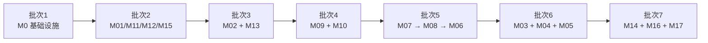

# 云游坊 - 开发任务总览

> 本文档汇总全部开发任务，由各模块任务文件聚合而成。
> 依据：`docs/design/01~04`、`docs/rules/database-rules.md`、`docs/rules/api-rules.md`
>
> 文档版本：v1.0
> 生成日期：2026-11-06
> 状态：待审核

---

## 一、总体统计

| 指标 | 数值 |
|---|---|
| 任务总数 | **213** |
| 预估总工时 | **339.5 小时** |
| 模块数 | 17 + 全局前置（M0） |
| P0 任务 | 145 |
| P1 任务 | 55 |
| P2 任务 | 13 |
| 单任务工时范围 | 0.5 ~ 2 小时（无超过 4 小时的任务） |

---

## 二、模块总览表

| 模块 | 任务文件 | 任务数 | 工时 | P0/P1/P2 | 主要任务类型 |
|---|---|---|---|---|---|
| **M0 全局前置** | `00.全局前置任务.md` | 14 | 24.0h | 10/4/0 | 后端 9、前端 2、联调 2、DB 1 |
| **M01 用户与账户** | `01.用户与账户任务.md` | 19 | 26.5h | 13/6/0 | API 11、前端 4、后端 2、DB 2 |
| **M02 景点内容** | `02.景点内容任务.md` | 13 | 22.5h | 8/4/1 | API 7、前端 4、后端 2 |
| **M03 对话交互** | `03.对话交互任务.md` | 12 | 20.0h | 10/2/0 | API 5、前端 4、后端 1、DB 1、联调 1 |
| **M04 旅游计划** | `04.旅游计划任务.md` | 13 | 20.5h | 11/2/0 | API 6、前端 4、后端 2、DB 1 |
| **M05 足迹** | `05.足迹任务.md` | 8 | 12.0h | 6/2/0 | API 3、后端 2、前端 2、DB 1 |
| **M06 Agent 引擎** | `06.Agent引擎任务.md` | 22 | 37.5h | 18/4/0 | 后端 21、测试 1 |
| **M07 记忆服务** | `07.记忆服务任务.md` | 5 | 6.5h | 2/3/0 | 后端 3、DB 1、API 1 |
| **M08 检索调度** | `08.检索调度任务.md` | 7 | 11.0h | 6/1/0 | 后端 7 |
| **M09 知识库** | `09.知识库任务.md` | 20 | 36.0h | 17/2/1 | API 8、后端 6、前端 4、DB 1、联调 1 |
| **M10 知识图谱** | `10.知识图谱任务.md` | 18 | 29.0h | 10/7/1 | API 8、后端 4、前端 4、DB 1、联调 1 |
| **M11 基础数据** | `11.基础数据任务.md` | 14 | 24.0h | 8/5/1 | API 8、前端 4、后端 1、DB 1 |
| **M12 模型管理** | `12.模型管理任务.md` | 10 | 15.0h | 7/3/0 | API 5、后端 2、前端 2、DB 1 |
| **M13 额度服务** | `13.额度服务任务.md` | 6 | 7.0h | 4/2/0 | 后端 2、API 2、DB 1、前端 1 |
| **M14 用户运营** | `14.用户运营任务.md` | 6 | 8.5h | 4/1/1 | API 4、前端 2 |
| **M15 系统管理** | `15.系统管理任务.md` | 10 | 15.0h | 6/4/0 | API 4、后端 2、前端 2、DB 2 |
| **M16 数据看板** | `16.数据看板任务.md` | 8 | 13.0h | 4/2/2 | API 6、后端 1、前端 1 |
| **M17 推荐引擎** | `17.推荐引擎任务.md` | 8 | 11.5h | 5/3/0 | 后端 6、API 1、前端 1 |
| **合计** | — | **213** | **339.5h** | **145/55/13** | — |

---

## 三、模块任务入口

| 模块 | 文件路径 | 说明 |
|---|---|---|
| M0 | [00.全局前置任务.md](./00.全局前置任务.md) | 工程骨架、配置、DB 连接、认证、基础设施 |
| M01 | [01.用户与账户任务.md](./01.用户与账户任务.md) | 注册登录、资料、偏好、隐私、通知 |
| M02 | [02.景点内容任务.md](./02.景点内容任务.md) | C 端浏览、详情、图谱、发现页 |
| M03 | [03.对话交互任务.md](./03.对话交互任务.md) | 会话管理、SSE 流式、方案卡片 |
| M04 | [04.旅游计划任务.md](./04.旅游计划任务.md) | 计划 CRUD、方案对比、状态流转 |
| M05 | [05.足迹任务.md](./05.足迹任务.md) | 足迹 CRUD、统计、公开流 |
| M06 | [06.Agent引擎任务.md](./06.Agent引擎任务.md) | LangGraph 编排、工具、ReAct、状态机 |
| M07 | [07.记忆服务任务.md](./07.记忆服务任务.md) | 长期记忆、惰性衰减、偏好提取 |
| M08 | [08.检索调度任务.md](./08.检索调度任务.md) | 多源并行检索、融合、降级 |
| M09 | [09.知识库任务.md](./09.知识库任务.md) | 知识库管理、文档处理链路、混合检索 |
| M10 | [10.知识图谱任务.md](./10.知识图谱任务.md) | 实体关系管理、Neo4j 同步、精选图谱 |
| M11 | [11.基础数据任务.md](./11.基础数据任务.md) | 省市、分类、景点、餐厅、酒店、交通、活动 |
| M12 | [12.模型管理任务.md](./12.模型管理任务.md) | 模型注册、连通性测试、调用统计 |
| M13 | [13.额度服务任务.md](./13.额度服务任务.md) | 额度计量、判定、配置 |
| M14 | [14.用户运营任务.md](./14.用户运营任务.md) | 用户列表、封禁、分群 |
| M15 | [15.系统管理任务.md](./15.系统管理任务.md) | 管理员、角色权限、操作日志、站点配置 |
| M16 | [16.数据看板任务.md](./16.数据看板任务.md) | 各类运营指标聚合 |
| M17 | [17.推荐引擎任务.md](./17.推荐引擎任务.md) | 埋点、热度、推荐策略、推荐理由 |

---

## 四、任务依赖图

### 4.1 批次依赖（非严格模块依赖）

> **重要说明**：模块之间存在**双向的任务级依赖**（如 M02 的 Repository 依赖 M11 的表，M11 的热度计算又依赖 M02 的埋点）。因此**不绘制完整模块依赖图**——那会产生视觉上的环。此处仅表达**批次推进顺序**。



**批次内允许并行的模块**：
- 批次 2：M01 可独立推进；M11/M12/M15 可并行
- 批次 4：M09 与 M10 相互独立，可并行
- 批次 7：M14/M16/M17 可并行（M16 需前序模块数据积累）

**批次间的实际硬依赖**：
- 批次 5 内部严格有序：`M07-T01` → `M08-T01` → `M06-T01`
- 批次 6 中 M03 依赖 M06，M04 依赖 M05

### 4.2 关键任务级依赖链

**M0 是全系统起点**，以下任务被全模块广泛依赖：
- `M0-T01` 后端骨架 → 12 处引用
- `M0-T02` DB 连接 → 12 处引用
- `M0-T13` DB 迁移基线 → **26 处引用**（所有 DB 迁移任务的起点）
- `M0-T07` Celery 初始化 → 14 处引用

**M06 Agent 引擎是最大汇聚点**，依赖 7 个模块：
```
M06-T03 (LiteLLM 适配) <- M12-T01
M06-T07 (数据库工具) <- M02-T01
M06-T08 (RAG/图谱工具) <- M08-T01
M06-T11 (记忆工具) <- M07-T01
M06-T15 (方案生成) <- M04-T01
M06-T16 (方案展示) <- M03-T05
M06-T18 (工作记忆) <- M03-T01
```

**M02 ↔ M11、M03 ↔ M06、M06 ↔ M12 的模块级双向依赖**：
- 在模块级：A 依赖 B 的某张表，B 依赖 A 的某项能力
- 在任务级：依赖指向**不同任务**，不构成环（已验证）

### 4.3 模块间双向依赖的说明（已验证非环）

以下三对模块在**模块级**互为依赖，但在**任务级**指向不同任务，**不构成循环**：

| 模块对 | 方向 A | 方向 B | 任务级验证 |
|---|---|---|---|
| **M02 ↔ M11** | `M02-T01` 依赖 `M11-T01`（建表） | `M11-T10` 依赖 `M02-T13`（埋点） | 无环 ✅ |
| **M03 ↔ M06** | `M03-T04` 依赖 `M06-T01`（引擎骨架） | `M06-T16`/`M06-T18` 依赖 `M03-T05`/`M03-T01`（会话表与交互接口） | 无环 ✅ |
| **M06 ↔ M12** | `M06-T03` 依赖 `M12-T01`（模型表） | `M12-T05`/`M12-T06` 依赖 `M06-T03`（LLM 调用层） | 无环 ✅ |
> **注**：`M05 → M07`（`M05-T08` 依赖 `M07-T01`）与 `M04 → M05`（`M04-T09` 依赖 `M05-T02`）均为**单向依赖**，不构成双向。

**执行建议**：这类双向依赖的模块，**在同一批次内交错推进**，先完成各自"被依赖的基础任务"（建表、骨架），再完成"依赖对方的增强任务"。

---

## 五、里程碑批次

### 批次 1：基础设施（M0，24h）

| 任务 | 说明 |
|---|---|
| M0-T01 ~ M0-T14 | 后端骨架、DB 连接、统一响应、Redis、JWT、外部服务封装、Celery、双前端工程、API 类型生成、日志、分页、迁移基线、部署编排 |

**验收标志**：后端可启动、前端两个工程可 build、迁移可执行、全栈容器 healthy。

---

### 批次 2：数据底座（M11 + M12 + M15 + M01 + M17-T02，81.5h）

| 模块 | 任务 | 说明 |
|---|---|---|
| M01 | 19 项 | 用户体系（其他所有 C 端功能的前提） |
| M11 | 14 项 | 省市/分类/景点/餐厅/酒店/交通/活动 |
| M12 | 10 项 | 模型注册与 LiteLLM 对接 |
| M15 | 10 项 | 管理员与权限体系 |
| **M17-T02** | **1 项（提前）** | 热度计算纯算法（`M11-T10` 数据管道依赖它，本身无任何依赖，故提前到本批次） |

**验收标志**：B 端可登录、可维护全部基础数据、模型可注册并测试连通性。

> **批次调整说明（评审 §Q5 落地）**：`M17-T02` 收窄为无依赖的纯算法函数后，`M11-T10`（热度数据管道）依赖它。为使 `M11-T10` 在批次 2 内可完成，`M17-T02` 提前至批次 2 执行；M17 其余任务仍在批次 7。

---

### 批次 3：C 端内容（M02 + M13，29.5h）

| 模块 | 任务 | 说明 |
|---|---|---|
| M02 | 13 项 | 首页/详情/图谱/发现页 |
| M13 | 6 项 | 额度服务 |

**验收标志**：C 端可浏览景点、查看详情与知识图谱（需 M10 部分数据）。

---

### 批次 4：知识资产（M09 + M10，65h）

| 模块 | 任务 | 说明 |
|---|---|---|
| M09 | 20 项 | 知识库全链路（上传→解析→切分→向量化→检索） |
| M10 | 18 项 | 知识图谱全链路（实体关系→Neo4j→同步） |

**验收标志**：文档可完整入库并检索召回；图谱可建设并在 C 端展示。

---

### 批次 5：能力层（M06 + M07 + M08，55h）

| 模块 | 任务 | 说明 |
|---|---|---|
| M07 | 5 项 | 记忆服务（M06 依赖） |
| M08 | 7 项 | 检索调度（M06 依赖） |
| M06 | 22 项 | Agent 引擎（最复杂） |

**验收标志**：三类意图可完成端到端对话，行程规划可产出方案。

---

### 批次 6：业务闭环（M03 + M04 + M05，52.5h）

| 模块 | 任务 | 说明 |
|---|---|---|
| M03 | 12 项 | 对话前台（SSE 渲染、交互弹窗） |
| M04 | 13 项 | 计划管理（方案对比、状态流转） |
| M05 | 8 项 | 足迹（含自动生成） |

**验收标志**：用户可从对话生成计划 → 确认 → 完成 → 自动生成足迹。

---

### 批次 7：运营与增强（M14 + M16 + M17，32h）

| 模块 | 任务 | 说明 |
|---|---|---|
| M14 | 6 项 | 用户运营 |
| M16 | 8 项 | 数据看板 |
| M17 | 7 项 | 推荐引擎（`M17-T02` 已在批次 2 完成） |

**验收标志**：B 端可查看完整运营数据；C 端首页有推荐位。

---

## 六、任务进度汇总

### 6.1 总体进度

| 模块 | 总任务 | TODO | IN_PROGRESS | BLOCKED | DONE | 完成率 |
|---|---|---|---|---|---|---|
| M0 | 14 | 14 | 0 | 0 | 0 | 0% |
| M01 | 19 | 19 | 0 | 0 | 0 | 0% |
| M02 | 13 | 13 | 0 | 0 | 0 | 0% |
| M03 | 12 | 12 | 0 | 0 | 0 | 0% |
| M04 | 13 | 13 | 0 | 0 | 0 | 0% |
| M05 | 8 | 8 | 0 | 0 | 0 | 0% |
| M06 | 22 | 22 | 0 | 0 | 0 | 0% |
| M07 | 5 | 5 | 0 | 0 | 0 | 0% |
| M08 | 7 | 7 | 0 | 0 | 0 | 0% |
| M09 | 20 | 20 | 0 | 0 | 0 | 0% |
| M10 | 18 | 18 | 0 | 0 | 0 | 0% |
| M11 | 14 | 14 | 0 | 0 | 0 | 0% |
| M12 | 10 | 10 | 0 | 0 | 0 | 0% |
| M13 | 6 | 6 | 0 | 0 | 0 | 0% |
| M14 | 6 | 6 | 0 | 0 | 0 | 0% |
| M15 | 10 | 10 | 0 | 0 | 0 | 0% |
| M16 | 8 | 8 | 0 | 0 | 0 | 0% |
| M17 | 8 | 8 | 0 | 0 | 0 | 0% |
| **合计** | **213** | **213** | **0** | **0** | **0** | **0%** |

### 6.2 按批次进度

| 批次 | 任务数 | 工时 | 完成率 |
|---|---|---|---|
| 1. 基础设施 | 14 | 24h | 0% |
| 2. 数据底座 | 53 | 85.5h | 0% |
| 3. C 端内容 | 19 | 29.5h | 0% |
| 4. 知识资产 | 38 | 65h | 0% |
| 5. 能力层 | 34 | 55h | 0% |
| 6. 业务闭环 | 33 | 52.5h | 0% |
| 7. 运营增强 | 22 | 33.5h | 0% |

---

## 七、规范与约束总览

所有任务遵循以下约束，具体检查项写入各任务 DoD。

### 7.1 技术栈（不可更换）

| 层 | 选型 |
|---|---|
| 后端 | Python 3.12 + FastAPI + Pydantic v2 + SQLAlchemy 2.x |
| Agent | LangGraph + LangChain + LiteLLM |
| 数据库 | PostgreSQL 15+ |
| 缓存 | Redis 7+ |
| 向量库 | Milvus 2.4+ |
| 搜索引擎 | Elasticsearch 9.x + IK 分词 |
| 图库 | Neo4j 5.x |
| 对象存储 | MinIO |
| 消息队列 | RabbitMQ + Celery |
| 前端 C 端 | Next.js 14 + TypeScript + Ant Design 5 |
| 前端 B 端 | Vite + React 18 + TypeScript + Ant Design 5 |
| 状态管理 | TanStack Query + Zustand |

### 7.2 数据库规范（`docs/rules/database-rules.md`）

| 规范 | 落实方式 |
|---|---|
| snake_case 命名 | 各 DB 迁移任务 DoD |
| 表名单数 | 各 DB 迁移任务 DoD |
| 主键 `id` + UUID | M0-T02、各 DB 迁移任务 |
| **禁止物理外键** | M0-T13 + 全部 14 个 DB 迁移任务 DoD 均含 grep 检查 |
| 业务唯一值唯一约束 | 各 DB 迁移任务 DoD |
| 金额 `NUMERIC` | 各 DB 迁移任务 DoD |
| 时间 `TIMESTAMPTZ` | M0-T02、各 DB 迁移任务 |
| 状态字段 CHECK | 各 DB 迁移任务 DoD |

### 7.3 API 规范（`docs/rules/api-rules.md`）

| 规范 | 落实方式 |
|---|---|
| REST 风格、名词路径 | M0-T03 + 各 API 任务 |
| HTTP 方法语义 | 各 API 任务 |
| 统一响应结构 | M0-T03 |
| 分页结构统一 | M0-T12 |
| HTTP 状态码语义化 | M0-T03 |
| 业务错误码分段 | M0-T03 |
| 参数校验（服务端） | 各 API 任务 DoD |
| 敏感信息不入 URL | M0-T05 |

---

## 八、评审待确认事项的确认结论

> 原 6 项待确认事项已于 2026-11-06 逐项与用户确认，结论如下。详细分析见 [评审结果文档](./18.任务列表评审结果.md) §8。

| 编号 | 事项 | 确认结论 | 落地位置 |
|---|---|---|---|
| **Q1** | Token 存储策略 | **Access Token 存内存，Refresh Token 存 httpOnly Cookie**（`Secure` + `SameSite=Lax`）；SSR 首屏不查询登录状态 | M01-T16、M01-T19、M15-T09 DoD |
| **Q2** | `activity` 表内容来源 | **平台运营手工录入**，不接第三方同步；M11-T09/T13 已覆盖，无需新增任务 | M11-T09、M11-T13（无改动） |
| **Q3** | 记忆置信度合并策略 | **加权平均 `新 = 旧 × 0.7 + 观测 × 0.3`（α=0.3，所有来源统一）**；观测值按来源分级（1.0/0.9/0.8/0.7/0.6/0.3） | M07-T02、M07-T03、M05-T08 |
| **Q4** | 用户分群口径 | **活跃 = 近 30 天 `user_event` 去重用户**；**沉默 = 超过 90 天未登录**；**高价值 = MVP 不做（返回 null）**；三分类互斥且不覆盖全部用户 | M14-T03 DoD |
| **Q5** | 热度计算职责划分 | **保留两个任务**：M17-T02 纯算法（无 IO，无依赖），M11-T10 数据管道（依赖 M17-T02）；因依赖关系，**M17-T02 执行批次由 7 提前至 2** | M17-T02、M11-T10、§五批次表 |
| **Q6** | 无原型页面的设计依据 | **前端按设计文档自行设计**，不要求补充原型 | M01-T16 等前端任务 |

---

## 九、下一步

1. 从**批次 1（M0 全局前置）**开始按批次推进开发
2. 每完成一个任务，更新对应模块文件中的「状态」与本章的进度汇总
3. 批次 2 中 `M17-T02`（热度纯算法）与 `M11-T10` 需相邻完成，顺序不可颠倒
